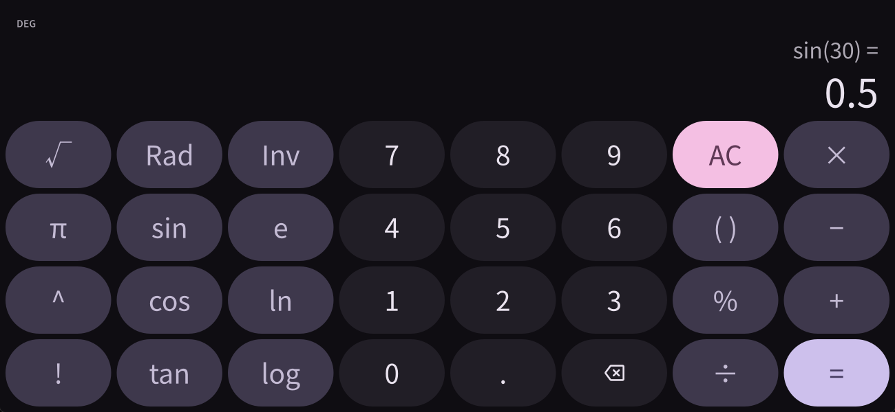
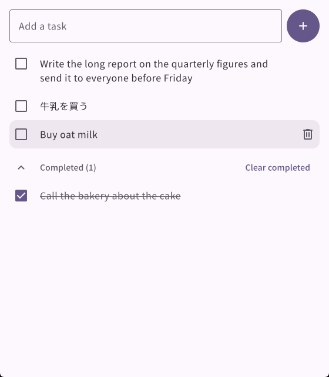

# lamina-ui

[English](README.md)

Material 3 Expressive を手本にした、SDL3 の上で動く C++ のデスクトップ向け UI ライブラリです。

lamina-ui は Google とは関係がなく、Google の承認も受けていません。Material Design は Google のデザインの体系で、lamina-ui はその公開されている指針とトークンの値に従っています。

 

## 現状

バージョン 0.1.0 です。API はまだ固まっておらず、0.x のどの版でも変わることがあります。ビルドして動かしたのは Windows 11 と Visual Studio 2022 だけです。ほかの OS 向けのコードも書いてありますが、ビルドしたことはありません。拡大率の違うモニターと Windows 10 でも確かめていません。

作り始めたところです。今あるのは、設計の値の層・2D の描画・文字・形・アイコン・SDL3 の窓・配置の仕組みと、部品（ボタン・アイコンボタン・FAB・スイッチ・チェックボックス・ラジオボタン・入力欄・スライダー・タブ・ナビゲーションバー・ナビゲーションレール・メニュー（従来のものと、まとまりに分けたもの）・ダイアログ・円形の進み具合の表示・スクロールする範囲・スナックバー・ツールチップ（簡素なものと詳しいもの）・チップ（アシスト・フィルター・入力・提案）とチップの組・カード・区切り線・バッジ・リストの項目とリストの表示・トップアプリバー（小さいもの・中央そろえ・中くらい・大きいもの・伸縮するもの）・セグメントボタン・範囲スライダー・日付の選択（その場に置くもの・ダイアログ・入力欄の下に開くもの・期間）・時刻の選択（文字盤と入力）と、Material 3 Expressive のボタンの組（ふつうのもの・つながったもの、はみ出しのメニューつき）・切り替えボタン・分割ボタン・三つの大きさの拡張 FAB・FAB メニュー・読み込み中の表示・直線と円の波のある進み具合の表示・浮かぶツールバー・柔軟な下のアプリバー）です。第 6 段階で、密度の段階、ウィンドウの大きさの区分、ナビゲーションスイートの足場、ペインの広さを変えるドラッグハンドルつきのリストと詳細・補助のペインの足場、大きさを変えられる分割ペイン、横のスクロール、詰めた数値欄を足しました。第 7 段階で、メニューのショートカットの表示・区切り線・サブメニュー、コンテキストメニュー、キーボードショートカットの登録簿、メニューバー、データテーブルを足しました。どの見本も、部品の位置を配置の仕組みで決めています。

- `lamina/tokens/motion.hpp`：standard と expressive の二つの動きの体系の、ばね・緩急・時間のトークン。どちらの体系も、Compose の `MotionScheme` と同じく6つのばねに役割の名前を付けています（`fast_spatial()`・`default_spatial()`・`slow_spatial()`・`fast_effects()`・`default_effects()`・`slow_effects()`）。部品はどれも `tokens::motion_scheme` からばねを取り、これは expressive の体系を指しています。
- `lamina/motion/easing.hpp`・`lamina/motion/tween.hpp`：3 次ベジェの緩急（`ease(curve, fraction)`。Compose の `CubicBezierEasing`）と、決まった時間で曲線に沿って目標へ動く値 `Tweened`。Compose がばねでなくトゥイーンで動かす、チップとカードの高さ（影）と、2 段のアプリバーの題名の消え方に使います。`tokens::CubicBezier` は `motion::CubicBezier` です。
- `lamina/motion/spring.hpp`：減衰するばね。解を式で直接求めます。`advance` は値を目標に向けて好きな時間だけ進めます。時間をどうコマに分けても結果は変わりません。`is_settled` は動きが止まったかを判定します。

- `lamina/tokens/shape.hpp`・`typography.hpp`・`elevation.hpp`・`interaction.hpp`：角の丸めの段階（`corner_radii(corners, width, height)` は `Corners` の組を四つの角の半径にします）、文字の段階（強調の段階を含む）、高さの段階、状態の重ねの不透明度と押せる範囲の最小の大きさ。これらの基礎のトークンはすべての部品で共有します。一つの部品のトークンは、その部品と同じ名前の `tokens/` のファイルにあります（`widgets/grouped_menu.hpp` には `tokens/grouped_menu.hpp`）。`TypeRole` には、Expressive の文字の段階にある 15 の役割と、その強調版 15 があります（`display_large_emphasized` から `label_small_emphasized` まで。`tokens::emphasized(role)` でも得られます）。値は Compose と同じで、大きさ・行の高さ・字間は元の役割と同じ、太さは 500（Title M・Title S・Label は 700）です。`LabelOptions::type` のように `TypeRole` を受け取る所なら、どこでも強調版を選べます。
- `lamina/color/scheme.hpp`：1 色から作る配色。`spec_2021().build(options)` と `spec_2025().build(options)` は、元の色・ライトかダークか・配色の種類（TonalSpot・Expressive・Vibrant など）・コントラストの段階から、2021 年または 2025 年の色の仕様で 53 個の色の役割（primary・primary-dim・surface-container・outline など）を返します。2021 年の仕様は Google の material-color-utilities（`third_party/`）が計算します。2025 年の仕様（`color/spec_2025.cpp`）は、同じライブラリの Java 版の `ColorSpec2025` をスマートフォン向けの部分だけ移したもので、C++ 版の HCT とコントラストの関数の上に作っています。Java 版との照合は `tools/color-dump/` で行います。どちらの仕様も、`color/mcu_scheme.cpp` で作る、そのライブラリの配色の種類ごとの配色から始めます。

- `lamina/render/canvas.hpp`：曲線・角丸の四角・影・座標変換の積み重ねを持つ 2D の描画面。描くのは ThorVG です（`lamina::thorvg`）。ThorVG を選んだ理由は [docs/renderer-comparison.ja.md](docs/renderer-comparison.ja.md) にあります。`fill_rect` はただの四角を塗り、バックエンドごとに実装します。ThorVG の描画面は `appendRect` を使わず、四角の曲線と同じ輪郭を渡します。ThorVG は軸にそろった4つの角の輪郭をなめらかにせずに塗るので、縁が変わってしまうためです。`draw_image(image, rect, opacity)` は `render::Image`（`render/image.hpp`：幅・高さと、行ごとに並べた ARGB の画素。アルファは乗算済みでないもの）を四角いっぱいに引き伸ばして描きます。座標変換とクリップに従い、不透明度は 0 から 1 です。Compose の `DrawScope.drawImage` に描き先の大きさとアルファを渡したときと同じです。ThorVG の描画面は呼ばれた時点で画素を写し取るので、画像を描画の終わりまで残しておく必要はありません。拡大縮小はバイリニアで補間します。`push_clip` は四角のほか任意の曲線も取ります。Compose の `Modifier.clip(shape)` と同じで、画像を Material の形に切り抜けます。`pop_clip` は最後のクリップを終え、クリップは入れ子にできます。`render/geometry.hpp` には点の計算（`+`・`-`・拡大・`length`・`unit`・`left_normal`・`cross`）と `circle_rect` があり、`render/path.hpp` は角丸の四角、枠線のための輪（`ring_path`）、円（`circle_path`）、点の列に沿って両端の丸い線の輪郭（`stroke_path`）を作ります。描画面は塗ることしかできないので、線もこの輪郭で塗ります。
- `lamina_sdl3/window.hpp`：描画面を映す SDL3 の窓。ポインターの位置を dp に直し、何も動いていない間はイベントを待って止まります（`lamina::sdl3`）。1 フレームの時間の刻みは 0.1 秒までですが、`wake_after` で頼んだ待ちの後だけは、待った時間をそのまま刻みに含めます。そのため、テキストフィールドのカーソルの点滅のように `step` で数える時間は、窓が止まっている間も進みます。窓は ThorVG に依存しません。描く先の描画面を `std::unique_ptr<render::Canvas>` で受け取り、毎フレーム `Canvas::resize` で窓の画素の大きさに合わせ、`Canvas::finish` が返す画素を 32 ビットの ARGB として画面に送ります。そのため、ARGB の画素に描く描画面であれば何でも差し込めます。`set_size(width, height)` は窓の中身の大きさを dp で変えます。最大化しているときは先に元に戻します。`set_minimum_size` は、利用者が枠を引いてそれより小さくできない大きさを dp で決めます。どちらもコンストラクターと同じく表示の倍率で dp を換算します。`set_always_on_top` は窓をほかの窓より手前に保ちます。`native_handle` は、OS ごとのコードのために、Windows では窓の `HWND` を返します（ほかの OS では null）。見本は `examples::window_canvas()`（`examples/common/canvas.hpp`）が作る ThorVG の描画面を渡しています。
- `lamina_sdl3/app.hpp`：`run_app` がその窓でフレームの繰り返しを回します。毎フレーム、フレームの情報（入力・大きさ・経過時間）を渡して `update` を呼び、`update` が返す背景色で描画面を塗りつぶして dp の縮尺に合わせ、`paint` を呼んで描かせてから画面に出します。`paint` はまだ動いているものがあるかどうかを返し、何も動いていなければ次のフレームはイベントを待ちます。Windows では、窓の枠をドラッグしている間、システムの中で別の繰り返しが回ります。そのため、イベントを取り出して回すだけの繰り返しでは、マウスを離すまで描き直されず、離したときに配置が新しい大きさへ飛びます。`run_app` は、ドラッグ中に SDL が送る大きさ変更中の再描画のイベントごとにも、入力なしで 1 フレーム描きます（`Window::on_live_resize`）。そのため、中身が枠に合わせてついてきます。窓を `WindowOptions` と描画面から作る形と、作ってある `Window` を受け取る形があり、コールバックの中で窓を使うとき（クリップボード、`set_text_input`、`wake_after`）は後者を使います。`run_app` は例外を捕まえません。例外は呼び出し側に届き、報告のしかたは呼び出し側が決めます。フォントの読み込みのように繰り返しの前の準備で起きた例外も、同じ処理で扱えます。自分で繰り返しを書くときは、これまでどおり `Window` の関数をそのまま使えます。
- `lamina/widgets/title_bar.hpp`・`lamina/input/caption.hpp`・`WindowOptions::client_title_bar`：Windows で lamina が自分で描くタイトルバー（選んだときだけ使います）。題名・アプリの部品・最小化・最大化（元に戻す）・閉じるのボタンを描き、ドラッグでの移動・スナップ・大きさの変更・影は Windows に任せます。`client_title_bar` を頼まない窓は OS の枠のままです。Windows 以外や、`LAMINA_CLIENT_TITLE_BAR=OFF` で組み立てたときは、頼んでも OS の枠になります。components・navigation・電卓・タイマー・ToDo リストの例は `--title-bar` を受け付けます。詳しくは [docs/custom-title-bar.ja.md](docs/custom-title-bar.ja.md) を見てください。
- `lamina_sdl3/resources.hpp`：`preference_directory(organization, application)` は、プログラムが自分のファイルを置いてよいフォルダーを返します（`SDL_GetPrefPath`。フォルダーがなければ作ります。Windows では `%APPDATA%\<organization>\<application>\` です）。得られないときは SDL の理由を添えたエラーを投げます。
- `lamina_sdl3/system_fonts.hpp`：OS のフォントから、日本語の画面の文字に使うフォントを探します。フォントのフォルダーは環境変数（`WINDIR`・`SystemRoot`・`LOCALAPPDATA`）から決め、候補を Noto Sans JP・Yu Gothic UI・Meiryo UI・BIZ UDPゴシック・MS UI Gothic の順に試します。どちらの一覧もヘッダーに置いたデータです。一つも見つからなければ、試したパスを全部並べたエラーを投げます。`font_stack_from_arguments` は、コマンドラインにフォントのファイルが渡されていれば、そちらを使います。`system_fallback_stack` は例外を投げずに空のスタックを返し、`typeface_stack(typeface, embedded)` は、埋め込んだフォントと、最後の代わりとしての OS のフォントから、書体のスタックを作ります（[docs/resources.ja.md](docs/resources.ja.md#文字のフォントと書体)）。
- `lamina/text/font.hpp`・`layout.hpp`：フォントと、1 行の文字・折り返す段落。文字の並べ方と字形の輪郭はどちらも HarfBuzz から取り、輪郭はほかの図形と同じく描画面で塗るので、FreeType は使いません。可変フォントは文字の段階の太さに合わせて太さを変え、`opsz` 軸があればその大きさを光学サイズにし（`text::Instance`）、フォントに無い文字は `FontStack` の次のフォントで補います。`FontStack` はフォントを `shared_ptr` で持つので、写しを作っても軽く済みます。部品はこの写しを持つので、部品を作ったときに渡した `FontStack` が部品より先に消えても構いません。フォントを持つ部品は代入もできます。段落は、欧文では空白で、日本語では文字の間で折り返し、。や 」などの約物は行頭に来ないようにします（`text/line_break.hpp`）。タブ文字は何も描かず、次のタブ位置まで進みます。タブ位置の間隔は空白 `TextStyle::tab_width` 個分（その書式での空白の幅で、字間も含みます）で、行の頭から数えます。`tokens::text_style` はこれを `tokens::tab_width_spaces`（4）にします。キャレット・クリック位置の判定・折り返しは、タブをその置かれた位置での幅で測り、単語ごとの移動ではタブを空白として扱います。単語ごとの移動や選択で使う単語は、同じ種類の文字（英字と数字・漢字・ひらがな・カタカナ・約物）の連なりです（`text/word_boundary.hpp`）。折り返しと単語の種類は、Unicode の範囲を同じ一つの表から取ります（`text/script.hpp`）。入力欄の編集の中身（文字列・選択・IME の変換中の文字・文字や単語や行ごとの移動）は `text::EditBuffer`（`text/edit_buffer.hpp`。改行とタブを残すかどうかは `EditBufferOptions` で決めます）で、フォントも描画面も使いません。行は文字の位置の範囲を並べた `text::LineMap`（`text/line_map.hpp`）として受け取り、横の位置は `text::CaretGeometry` という口を通して尋ねます。この口は、入力欄が並べ終えた行を使って実装しています。取り消しの履歴もこのバッファーが持ちます（`text::EditHistory`、`text/edit_history.hpp`）。履歴のひとまとまりごとに、編集の前と後の文字・選択の起点・カーソルを残し、取り消しとやり直しではそのどちらかに戻します。`type` は打った文字で、直前のまとまりに続けてまとめることがあります。`insert`・`erase_selection`・IME の確定は、それぞれ一つのまとまりになります。`advance(dt)` で履歴に時間を渡し、`close_step()` で打っている途中のまとまりを区切ります。履歴の上限は `EditBufferOptions::history` で渡し、渡さなければ履歴は残しません。`text::underline(fonts, style)` は、その書式で下線を引く位置を返します。`offset` はベースラインから線の上端までの下向きの距離、`thickness` は線の太さで、どちらも最初のフォントが持つ下線の値（`Font::underline_em()`）から取ります。フォントにその値が無いときは、HarfBuzz がフォントの高さの値から作ります。
- `lamina/widgets/button.hpp`：Material 3 Expressive のボタン。5 種類（filled・tonal・outlined・elevated・text）・5 段階の大きさ・2 種類の形。押すと、Compose と同じく効果のばねで角が押したときの形に変わり、マウスを乗せたときと押したときには状態の重ねと高さが変わります。`ButtonOptions::leading_icon` でラベルの前にアイコンを置けます。大きさと間隔は大きさのトークンに従います。ラベルが空なら、アイコンだけが中央に置かれます。ボタンの高さは大きさのトークンで決まり、幅は中身で決まります。`set_size(width, height)` を使うと、ほかの大きさにできます（電卓のキーはこれで格子の枠いっぱいになります）。そのときもラベル・アイコン・角は大きさのトークンに従い、丸い形のボタンは新しい高さでも丸いままです。`ButtonOptions::colors` は、Compose の `ButtonDefaults.buttonColors` と同じく、種類が決める入れ物と中身の色の役割を差し替えます。高さと輪郭は種類のままです。入れ物を `std::nullopt` にすると入れ物を描かないので、スナックバーの操作のように、ほかの面の上で中身の色だけを変えたテキストボタンにできます。`set_label` はラベルを変えます（大きさを与えていないボタンは幅を合わせ直します）。`set_content_scale(label, icon)` は、ラベルとアイコンをトークンより大きく、または小さく描きます。電卓は、これでキーの文字をキーの大きさに合わせて大きくします。`set_shape(shape)` は、角を丸と四角の間で速い空間のばねで変えるので、タイマーの一時停止と再開のキーのような切り替えは少し行き過ぎて戻ります。`set_icon` は、速い効果のばねで古いアイコンから新しいアイコンへ入れ替えます。`ButtonOptions::icon_style` は、アイコンを Material Symbols の別の軸の値で描きます（タイマーの再生と一時停止は塗り 1 です）。押したときの形の変化はこの形の上に重なるので、両方が同時に動けます。`cancel_interaction()` は、ポインターの出来事なしにマウスを乗せた状態と押した状態を取り消すので、押している途中のものはクリックになりません。ポインターの入力を受け取る部品はどれもこれを持ちます（スライダーではドラッグを、入力欄ではドラッグでの選択を、ダイアログではボタンへの押し込みを終わらせます）。ダイアログは閉じるときに自分のボタンにこれを使い、`WidgetSet::cancel_interaction()` はこれを持つ部品に伝えます。`build/Release/buttons.exe` で全部を並べて見られます。
- `lamina/icons/`：フォントとしての Material Symbols。`Symbol` はコードポイントで、`IconFont` は HarfBuzz から取った輪郭で記号を好きな大きさと色で描きます。フォントの可変軸（塗り・太さ・グレード・光学サイズ）も指定でき、光学サイズは指定しなければ描く大きさに合わせます。`text::Font` には `glyph_for` と、軸の値を受け取る `glyph_outline_em` を足しました。
- `cmake/LaminaResources.cmake`・`lamina/resources/resource.hpp`：Android の `R` クラスのように実行ファイルに埋め込むリソース。`lamina_add_resources(<name> ICONS ... ICON_FONTS ... TEXT_FONTS ... FILES ...)` は、ビルドの段階でアイコンのフォントを書いた記号だけに切り出し、それと、書いた同梱の文字のフォント（Google Sans Flex・Roboto Flex・Noto Sans JP）と、ほかのファイルをバイトの配列として埋め込み、型の付いた定数のヘッダー（`app::res::icons::play_arrow`・`app::res::fonts::symbols`・`app::res::files::logo`）を書き出します。アイコンの名前を書き間違えるとビルドが止まります。`IconFont::from_resource` と `text::Font::from_resource` は、ファイルを使わずにそこから読みます。見本とテストもこれを使い、ビルドしたプログラムは隣にフォルダーを置かずに動きます。詳しくは [docs/resources.ja.md](docs/resources.ja.md)。
- `lamina/widgets/icon_button.hpp`：アイコンボタン。4 種類（filled・tonal・outlined・standard）・5 段階の大きさ・2 種類の形・3 種類の幅（narrow・uniform・wide）。ボタンと同じく、押すと効果のばねで角が変わります。切り替えのアイコンボタンは、オンのときにも形と色が変わります。`set_icon` は、ボタンと同じく速い効果のばねで別のアイコンへ入れ替えます。
- `lamina/widgets/fab.hpp`：フローティングアクションボタン。3 段階の大きさ（FAB・medium・large）で、地は primary-container か secondary-container です。高さは段階 3 で、マウスを乗せると段階 4 になります。
- `lamina/widgets/switch.hpp`：スイッチ。つまみは速い空間のばねで滑りながら大きさを変え（オフで 16 dp、オンかアイコンつきで 24 dp、押している間は 28 dp）、expressive では少し行き過ぎて戻ります。つまみには、オンとオフそれぞれのアイコンを載せられます。
- `lamina/widgets/checkbox.hpp`：チェックボックス。オフ・オン・中間の 3 状態です。チェックの印は空間のばねで線の長さに沿って描かれ、中間の状態では横線へ寄っていきます。オフにすると、Compose と同じく箱の色が薄れる間に 100 ms 遅れて印が消えます。
- `lamina/widgets/radio_button.hpp`：ラジオボタン。点は速い空間のばねで大きくなります。
- `lamina/widgets/slider.hpp`：Expressive のスライダー。4 × 44 dp のつまみが 16 dp の通り道を、動いた側（primary）と残りの側（secondary container）に分けます。つまみの両側には 6 dp の隙間があり、つまみの側の角は 2 dp です。終わりには 4 dp の点が付きます。スライダーのどこかを押すかドラッグすると、ポインターの位置から値が決まります。ドラッグの途中でポインターがスライダーの外に出ても追います。押している間、つまみは Compose と同じくすぐに 2 dp に細くなります。`SliderOptions::steps` を指定すると、値は等しい間隔の目盛りに寄ります。スライダーは `Focusable` で、`handle(KeyEvent)` はキーボードのフォーカスがある間だけ値を動かします。右か上の矢印と左か下の矢印で 1 段（段が無ければ 1 %）、`Page Up` と `Page Down` で段の数の 10 分の 1（1 段から 10 段まで。段が無ければ 10 %）、`Home` と `End` で両端へ動き、値が変わったとき true を返します。フォーカスがあると、押したときと同じくつまみが細くなり、つまみの周りにフォーカスの輪を描きます。押すとフォーカスは外れるので、クリックしただけではキーは届きません。`SliderOptions::orientation` で縦向きになります（Compose の `VerticalSlider`）。つまみは 44 × 4 dp、トラックは幅 16 dp で、`top_to_bottom` を false にしない限り最小値が上です。キーは `↑`・`↓`・`Page Up`・`Page Down`・`Home`・`End` だけで、描いた向きに動きます。`centered` は Compose の `CenteredTrack` で、塗った部分が中央からつまみまで伸び、つまみと反対側に 6 dp の隙間があり、両端に止まりの点が付きます。`track_corner` はトラックの外側の角（既定は太さの半分）を決め、Compose の `Track(trackCornerSize)` と同じく、段がなければ塗っていない部分を幅 0 まで残します。`value_label`（値から文字を作る関数。文字を渡すコンストラクタと一緒に使います）を渡すと、つまみを押している間とフォーカスがある間、つまみの上に値の表示が出て、その文字が読み上げ用の値になります。inverse-surface の丸い札に Label L の文字で、つまみの 12 dp 上に置き、下端から 100 ms の強調の曲線で大きくなります。値の表示は横向きのスライダーだけに出ます。Compose にはトークン（`SliderTokens.ValueIndicator*`）しかないので、大きさと動きは material-web の `labeled` のスライダーに合わせました。スライダーは `Measurable` で、横向きは渡された幅、縦向きは渡された高さを取るので、`widgets::node` でこれまでどおり置けます。`lamina/widgets/slider_track.hpp` に、スライダーと範囲スライダーが共有するトラックの描画・段への合わせ方・キーの段の幅があります。
- `lamina/widgets/range_slider.hpp`：Compose の `RangeSlider`。一本のトラックに二つのつまみがあり、つまみの間を塗り、外側を塗らずに、両端に止まりの点を付けます。`steps` は両方を同じ目盛りに合わせます。押すと近いほうのつまみが動きます（同じ距離なら、押した位置がつまみより前なら始まりのつまみ、それ以外は終わりのつまみ）。つまみが重なっているときは、ドラッグの向きで動くほうを選びます。重なることはあっても、追い越すことはありません。つまみはそれぞれが Tab の止まり位置です。`thumb(RangeThumb::start)` と `thumb(RangeThumb::end)` は `Focusable` で `FocusGated` なので、プログラムが `FocusManager` に足します。キーはスライダーと同じで、`Home` と `End` はもう一方のつまみで止まります。読み上げでは `group` の中に、つまみごとの `slider` があり、`RangeSliderOptions::names`（既定は Compose の "Range start" と "Range end"）で名前を付け、範囲はもう一方のつまみまでです。`value_label` はスライダーと同じく、それぞれのつまみに値の表示を出します。
- `lamina/widgets/segmented_button.hpp`：Compose の `SingleChoiceSegmentedButtonRow` と `MultiChoiceSegmentedButtonRow`（`SegmentSelection`）。区画は高さ 40 dp、幅はいちばん広い区画にそろえ（最小 58 dp）、左右に 12 dp、18 dp のアイコンの場所と、Label L の文字の前に 8 dp を空けます。1 dp の枠線は隣の区画と重なり、最初と最後の区画は外側の角を丸くします。選ばれた区画は secondary-container で塗ります。アイコンのない区画もアイコンの場所を取っておき、選ばれていない間は文字を 13 dp 戻します。選ぶとチェックの印が左下から速い空間のばねで大きくなりながら文字が横へずれ、外すと印はすぐに消えて文字が戻ります（Compose の `SegmentedButtonDefaults.Icon`）。アイコンのある区画は、標準の効果のばねでアイコンとチェックの印を入れ替えます。アイコンだけの区画には `accessible_name` が要ります。行全体で Tab の止まり位置は一つです。一つだけ選ぶ行では、ラジオボタンの組と同じく `←`・`→`・`Home`・`End` で選び、いくつでも選べる行では、それらでフォーカスを動かして `Space` か `Enter` で切り替えます。読み上げでは、`group` の中のラジオボタンか切り替えボタンです。
- `lamina/calendar/`：ピッカーが使う日付の計算で、部品のコードは含みません。`date.hpp` は先発グレゴリオ暦（`Date`・`YearMonth`・うるう年・月の日数・どの年でも 1970-01-01 からの日の番号・曜日・日と月の足し算・週の始まりに合わせた月の並び）です。`format.hpp` は CLDR の書式（`MMMM`・`EEEE`・`d`・`y`・`h`・`H`・`mm`・`a`・引用符で囲んだ文字）で日付と時刻を書き、`MM/dd/yyyy` のような入力の書式で 8 桁の数字を読みます。`locale.hpp` の `CalendarLocale` には、週の始まりの曜日、月と曜日の名前、Compose が使う書式（`yMMMM`・`yMMMd`・`yMMMMEEEEd` を CLDR が展開したもの）、入力の書式、12 時間制か 24 時間制か、ピッカーが出すすべての文字（`PickerStrings`。Compose の文字列の資源から取りました）が入っています。`english_us()`・`english_gb()`（月曜始まり・日が月より先・24 時間制）・`japanese()` を用意しました。プログラムが自分で作ることもできます。
- `lamina/widgets/date_picker.hpp`：Compose の `DatePicker`。幅 360 dp です。上に見出し（Label L の題、Headline L の選んだ日付、カレンダーと文字入力を切り替えるボタン）と区切り線があり、その下に月と年のボタンと前後の月のボタンの行、曜日の頭文字（短い名前で、ロケールの週の始まりから）、48 dp のます目に 40 dp の日が 6 週並びます。選んだ日は primary の丸で、標準の効果のばねで現れます。今日には 1 dp の primary の輪を付けます。`SelectableDates` が許さない日と、年の範囲（既定は 1900〜2100）の外の日は 38 % で、選べません。矢印のボタンで、月が標準の効果のばねで横へ滑ります。月と年のボタンはカレンダーの上に年の一覧を開きます。72 × 36 dp の年を 3 列、16 dp 空けて並べ、表示中の年が 2 行目に来るようにスクロールした状態で、下へ広がりながら標準の効果のばねで 60 % から現れ、閉じるときは速いばねで消えながら畳まれます。年を選んでも月はそのままです。文字入力では、ロケールの書式（MM/DD/YYYY や YYYY/MM/DD）を枠にした入力欄が数字だけを受け取り、区切りの文字はその部分が埋まった時点で出ます。8 桁そろうと Compose と同じく調べ、ありえない日付・範囲外の年・許されない日付には、それぞれ Compose の文を入力欄の下に赤で出します。モードを切り替えると、新しい中身が滑り込み、古い中身が出ていきながら薄れ（標準の空間のばね）、高さも追いつきます。切り替えて 300 ms 後に入力欄にフォーカスが移ります。`add_focus_stops(focus)` は、モードのボタン・月と年のボタン・矢印・日のます目・年の一覧・入力欄を、出ているときだけ止まる位置として `FocusManager` に足します。日のます目は Tab の止まり位置一つで、フォーカスのある日を持ちます。矢印で 1 日か 1 週、`Page Up` と `Page Down` で 1 か月（Shift と一緒なら 1 年）、`Home` と `End` で週の初めと終わりへ動き、`Space` か `Enter` で選びます。Compose はこれらのキーを既定のフォーカス探しに任せているので、WAI-ARIA の日付の表に従いました。別の月へ入るとその月へ滑ります。年の一覧は矢印・`Home`・`End` と `Space` か `Enter` を受けます。日は読み上げではボタンで、Compose の説明と同じく日付をすべて書いた名前を持ち、今日には "Today" が前に付きます。年のボタンは "Navigate to year 2026" です。`show_header` を切るとカレンダーだけになります。
- `lamina/widgets/date_range_picker.hpp`：Compose の `DateRangePicker`。見出しに Title L で「開始日 - 終了日」、その下に曜日の行と、縦にスクロールする月の一覧があり、月ごとに月の名前（Title S）と 6 週が並びます。描くのは見えている月だけです。最初のクリックで開始日、その日以降の次のクリックで終了日が決まり、開始日より前か、期間がそろった後のクリックでやり直します。間の日は secondary-container の帯でつなぎ、帯は二つの丸の中心で始まって終わります。文字入力では二つの欄が横に並び、終了日が開始日より前（または開始日が終了日より後）だと "Invalid date range input" を出します。モードは速い効果のばねで入れ替わります。ます目は同じキーを受け、フォーカスのある日が見えるようにスクロールします。
- `lamina/widgets/docked_date_picker.hpp`：末尾にカレンダーのボタンが付いた日付の入力欄で、ボタンを押すと欄の 4 dp 下にカレンダー（見出しのない `DatePicker`）を開きます。面は surface-container-high、角は 16 dp、影は 6 dp です。日を選ぶと欄に入って閉じ、欄に日付を打つとカレンダーがその日へ移ります。`Esc`・外を押す・ボタンで閉じ、欄で `Alt+↓` を押すと、選んだ日にフォーカスを置いて開きます。Compose には欄の下に開く日付の選択がないので、面の色・角・影・幅は material-web の docked の日付の選択のトークンから取り、隙間と動きは lamina-ui が決めました。ピッカーはアイコンボタンを見せる（`mode_toggle()`・`previous_button()`・`next_button()`・`open_button()`・`PickerDialog::leading()`）ので、Compose の `IconButtonWithTooltip` のように、プログラムが名前のツールチップを付けられます。components の例はそうしています。
- `lamina/widgets/picker_dialog.hpp`：ピッカーをダイアログにする部品で、Compose の `DatePickerDialog` と `TimePickerDialog` にあたります。`DialogPane`（`PaneOf<W>` が部品をつなぎます）でどのピッカーも持ち、その下に Cancel と OK の文字ボタンを置きます。日付の配置では、ピッカーを角 28 dp の面いっぱいに置き、ボタンは末尾から 6 dp・下から 8 dp です。時刻の配置では 24 dp 空け、ピッカーの上に Label M の題、ボタンの行の先頭にアイコンボタン（モードの切り替え）を置きます。ダイアログと同じく幕とともに 0.8 から大きくなって開きます。Tab はピッカーとボタンを巡り、`Esc` か幕を押すと閉じ、`handle` は `DialogResult` を返します。
- `lamina/widgets/time_picker.hpp`：Compose の `TimePicker` と `TimeInput`。文字盤のモードでは、時と分を 96 × 80 dp の箱（Display L。選ばれた側は primary-container）にコロンを挟んで出し、12 時間制では AM/PM の切り替え（4 dp 離した二つのボタン。丸い形で、選ばれるか押されると速い空間のばねで角 12 dp になり、選ばれた側は primary-container で文字が太字）を置きます。その下が 256 dp の文字盤で、数字は半径 101 dp の円に（24 時間制の時は 12〜23 を半径 69 dp の内側の円にも）並び、48 dp の primary のつまみの下では数字が on-primary になり、2 dp の線と 8 dp の中心があります。`TimePickerLayout` で、表示を文字盤の上（縦）か横（横。切り替えは箱の下）に置きます。押すと、つまみが標準の空間のばねでいちばん近い時か 5 分へ動き、時を選んだときは、つまみが止まってから 100 ms 後に分へ移ります。ドラッグではつまみが指に付いて動き、いちばん近い時か分になり、離したときに分へ移ります。24 時間制では、中心からの距離（74 dp）で内側か外側かを決めます。数字の組は標準の効果のばねで入れ替わります。入力のモードは 96 × 72 dp の二つの欄（Display M）で、2 桁ずつ受け取り、埋まっていれば打った数字で置き換え、時を 2 桁（12 時間制なら 2〜9 の 1 桁）打つと分へ進み、下に "Hour" と "Minute"、範囲外なら Compose の文を赤で出します。Tab は、時と分の箱（ラジオボタン）、AM/PM の切り替え（止まり位置一つで、矢印で選び、`Space` か `Enter` で切り替え）、文字盤の順に巡ります。文字盤では Compose と同じく矢印で数字の間をフォーカスが動き、`Space` か `Enter` で選びます。入力のモードでは二つの欄と切り替えを巡ります。文字盤の数字は読み上げではボタンで、名前は Compose と同じです（"3 o'clock"・"15 hours"・"20 minutes"）。`is_24_hour` の既定はロケールの時計です。Compose の時刻の選択には無効の状態がありません。`set_enabled(false)` は、ほかの部品と同じく 38 % に薄めて操作を止めます。
- `lamina/widgets/focus_stop.hpp`：`FocusStop` は、ピッカーの日のます目のような複合部品の一部を、`Focusable` で `FocusGated` な `FocusManager` の一員にします。`forward_focus` は、出ているときだけ止まる子の部品のための `FocusStop` を作ります。
- `lamina/widgets/tabs.hpp`：primary と secondary のタブの列（`TabRow`）。タブは幅を等しく分けます。ラベルの上（このとき列は 72 dp の高さ）か前（`TabIconPosition::leading`）にアイコンを置けます。印は標準の空間のばねで選んだタブへ滑ります。primary のタブではラベルと同じ幅（少なくとも 24 dp）、secondary のタブではタブの幅いっぱいです。ラベルの色は、Compose と同じく、現れるときは標準の効果のばね、消えるときは速い効果のばねで移ります。タブの列は Tab の順の中で一つの止まり位置です（`Focusable`）。フォーカスがある間は、左右の矢印で前後のタブを選び（端では反対の端へ戻ります）、`Home` と `End` で最初と最後のタブを選びます。`handle(KeyEvent)` は、クリックと同じく選択が変わったときに true を返します。選ばれたタブはフォーカスの状態の重ねを出し、material-web のタブと同じく、フォーカスの輪をタブの縁の内側に描きます（項目の並ぶ部品が共通に使うキーの決まりは `widgets/item_focus.hpp` にあります）。
- `lamina/widgets/navigation_bar.hpp`：Expressive の短いナビゲーションバー。高さ 64 dp で、項目は同じ幅に並びます。選んだ項目の印（56 × 32 dp）は、標準の空間のばねで中央から広がりながら現れます。マウスを乗せたときと押したときは、印の形に状態の重ねが出ます。`NavigationItem::selected_style`（`lamina/widgets/navigation_item.hpp`。レールと共通です）で、選んだときのアイコンに別の Material Symbols の軸の値（たとえば塗り 1）を与えられます。アイコンは色と一緒にその値へ移ります。`set_labels(false)`（または `NavigationBarOptions::labels`）で名前を隠せます。標準の空間のばねでバーは高さ 48 dp に縮み、印は上下の中央に来ます。名前は動きの前半で消えます。
- `lamina/widgets/menu.hpp`：ドロップダウンメニュー。`open(anchor, window)` は元の部品の下に置き、収まらなければ上か窓の端に置きます。メニューは元の部品から広がるように、速い空間のばねで 0.8 倍から大きくなり、速い効果のばねで現れます。項目には前に置くアイコンを付けられ、マウスを乗せたときと押したときに状態の重ねが出ます。項目を選ぶか、メニューの外を押すか、`Escape` を押すと閉じます。`handle` は選んだ項目と、そのイベントを使ったかどうかを返すので、イベントは後ろの部品に届きません。キーは material-web のメニューに従います。`InputSource::keyboard`（`open` の 3 番目の引数）で開くと最初の項目にフォーカスを置き、すぐに輪を見せます。ポインターで開いたときは、↓（最初の項目へ）か ↑（最後の項目へ）を押すまでどの項目にもフォーカスを置きません。その後は ↑ と ↓ で項目の間を動き（端では反対の端へ戻ります）、`Home` と `End` で最初と最後へ動き、`Enter` か `Space` でフォーカスのある項目を選んで閉じます。`handle(KeyEvent)` も `MenuResponse` を返すので、キーで選んだときもクリックと同じ受け手に届きます。`Escape` か `Tab` では選ばずに閉じ、`OverlayStack::set_focus` を使っていれば、フォーカスはメニューを開いた部品に戻ります。フォーカスのある項目（`focused_item()`）はフォーカスの状態の重ねを出し、縁の内側に輪を描きます。メニューの中を押すと、キーボードのフォーカスは終わります。項目には Windows のメニューと同じくアクセスキーがあります。`MenuItem::access_key` で英字か数字のキーを指定します（それ以外のキーを渡すと `std::invalid_argument` を投げます）。指定のない項目は、見出しの最初の文字が ASCII の英字か数字ならそれを使います。`&` を付けない Win32 のメニュー項目と同じです。メニューが開いているあいだ、そのキーを単独で（Shift・Ctrl・Alt なしで）押すと、そのキーを持つ項目が一つならそれを選んで閉じます。その項目で `Enter` を押したときと同じです。同じキーを持つ項目が複数あるときは、押すたびに次の項目へフォーカスを動かし、選びはしません。どの項目も持たないキーは何もしません。押し続けて繰り返されたキーでは選びません。キーはメニューをどう開いても効き、表示するのはキーボードを使ってからです（`access_keys_shown()`）。Windows もキーボードを使うまで表示しないためです。キーボードで開いたときはすぐに表示し、ポインターで開いたときは、キーでフォーカスを動かすかアクセスキーに当たったときに、速い効果のばねでにじませて表示します。表示するときは、見出しの中でそのキーの文字が最初に出てくるところ（大文字か小文字かは問いません）に下線を引き、日本語の見出しのようにその文字が無いときは、日本語版の Windows の `共有(S)` のように見出しの後ろにかっこ付きでキーを置き、その文字に下線を引きます。メニューの幅は常にかっこの分も含めて測るので、どちらの開き方でも幅と位置は同じです。ポインターで開いたときはキーボードを使うまで下線もかっこも描きませんが、かっこの分の幅は空けたままなので、あとから表示しても何も動きません。下線の位置と太さはフォントが持つ値（`text::underline`）で、太さは 1 dp 以上にします。かっこの文字は `tokens/access_key.hpp` にあります。キーの照合と描画は `widgets/access_key.hpp` にまとめ、二つのメニューで共有します。
- `lamina/widgets/grouped_menu.hpp`：Expressive の、まとまりに分けたメニュー（`DropdownMenuPopup` と `DropdownMenuGroup`）。まとまりはそれぞれが一枚の面（色は surface-container-low、影は段階 2）で、次のまとまりと 2 dp 離れます。上に見出しと区切り線を置けます。最初と最後のまとまりは外側の角が 16 dp、内側の角が 8 dp です。マウスが一度乗ってから離れたまとまりは、角が 8 dp になります。項目は左右に 4 dp 引っ込み、高さは 44 dp 以上で、まとまりの最初と最後の項目は外側の角が 12 dp です。選んだ項目は色が tertiary-container になり、角が 12 dp に変わります。形は速い空間のばねで、色は速い効果のばねで動きます。押したときの動きは `MenuGroup::selection` で決めます。`none` は項目を知らせてメニューを閉じ、`single` はまとまりの中で一つを選び、`multiple` は項目の選択を切り替えます。後の二つではメニューは開いたままです。項目には後ろに置くアイコンと、選んだときの前のアイコンを付けられます。置き方は従来のメニューと同じですが、窓の左右の端からは 8 dp 離します。キーも従来のメニューと同じで、すべてのまとまりの項目を順にたどります。`Enter` か `Space` はフォーカスのある項目をクリックしたときと同じ動きをするので、`single` と `multiple` のまとまりではメニューは開いたままです。`handle(KeyEvent)` は `GroupedMenuResponse` を返し、輪は項目の角に沿います。項目には従来のメニューと同じアクセスキーもあり（`GroupedMenuItem::access_key`。すべてのまとまりの項目を順に照らし合わせます）、表示の仕方も同じです。一つの項目だけが持つキーは、その項目をクリックしたときと同じ動きをします。`single` と `multiple` のまとまりでは項目を選ぶか切り替え、その項目にフォーカスを置き、メニューは開いたままです。
- `lamina/widgets/dialog.hpp`：基本のダイアログ。窓全体を幕（色は scrim、不透明度 32 %）で覆い、面（幅 280 から 560 dp・角 28 dp）に見出し・本文・終わりの側にそろえたテキストボタンを `lamina::layout` で並べます。`DialogOptions::icon` を与えると見出しの上に 24 dp のアイコン（色は secondary）を置き、見出しは中央にそろえます。ボタンは終わりの側から並び、一行に収まらないときは、確定のボタンが一行目に残り、閉じるボタンが次の行に移ります。どちらも終わりの側にそろえます。0.8 倍から大きくなりながら現れます。確定か閉じるのボタン、幕を押す、`Escape` のどれかで閉じます。`open(size)` は窓全体を覆います。`open_in(area)` と `set_area(area)` は、幕と中央の面を窓の中の矩形（自前で描くタイトルバーの下など）に置きます。その矩形の外を押しても閉じません。開いているダイアログは、キーボードのフォーカスをどれかのボタンに置きます。`DialogOptions::default_action` があればそのボタンに、なければ読む順で最初のボタン（閉じるボタン。ボタンが折り返したときは確定のボタン）に置きます。`InputSource::keyboard`（`open` と `open_in` の二つ目の引数）で開くと、すぐにフォーカスの輪を見せます。ポインターで開いたとき（既定）は、フォーカスを持ったまま、Tab が押されるまで輪を見せません。Tab と Shift+Tab はボタンの間だけを巡り、Enter か Space でフォーカスのあるボタンが押され、Escape で閉じます。Compose の `AlertDialog` と同じ振る舞いです。`focused_action()` と `focus_shown()` で状態がわかります。`DialogOptions::content`（`DialogContent`：配置の節点、その部品を持つ `WidgetSet`、部品の Tab の順を持つ `FocusManager`（なくてもよい））を与えると、見出しと操作のボタンの間に好きな部品を置けます。本文があるときはその下です。Compose の `AlertDialog` の本文の枠と同じ位置です。ダイアログが、範囲から上下 48 dp ずつ引いた高さより高くなるときは、この枠が縮んで `ScrollArea` の中でスクロールします。ホイールは `handle(WheelEvent)` で届きます。ポインターの出来事は中身の座標に直して中身へ渡し、文字の出来事は中身の部品にフォーカスがあるときに渡します。`caret_area()` と `next_wake_seconds()` は中身の入力欄の分も返します。Tab は中身のフォーカスの順をたどってから操作のボタンへ進み、端では先頭へ戻り、フォーカスを得た部品が見えるようにスクロールします。`set_action_enabled` で操作のボタンを無効にでき、フォーカスはそのボタンを飛ばします。中身の中の Tab はいつもフォーカスを移すので、タブを受け付ける入力欄を中身に置いても、タブは打てません。
- `lamina/widgets/snackbar.hpp`：スナックバー。窓の下に短い知らせを出し、テキストボタンの操作を一つ付けられます（`SnackbarOptions::action_label`）。`set_area(rect)` で置く場所を渡すと、下から 12 dp 上の中央に、場所の幅いっぱい（最大 600 dp）で置きます。高さは Body M の 1 行で 48 dp（2 行で 68 dp）、面は `inverse_surface`、角は 4 dp、影は Level 3 です。知らせの文字は `inverse_on_surface`、操作は `inverse_primary` です。`show(message)` は Compose の `SnackbarHost` と同じく、0.8 倍から速い空間のばねで大きくしながら速い効果のばねで現し、時間を数え直します。`SnackbarOptions::duration_seconds`（既定は Compose の短い時間の 4 秒）がたつと自分で消えますが、ポインターが乗っている間は時間が進みません。残りの時間は動きではなく起きる時刻（`next_wake_seconds()`）として知らせるので、待つ間も窓は止まっていられます。`handle(PointerEvent)` は `SnackbarResponse` を返し、操作が押されたら `action`（スナックバーは閉じます）、ポインターが上にある間は `consumed` が立ちます。そのため `OverlayStack` のモードレスな重なりとして使えます。操作のボタンはキーボードのフォーカスを受けます。スナックバーは `Focusable` で `FocusGated`（表示中で操作があるとき `can_focus()` が true）なので、プログラムは `FocusManager` に加えます。フォーカスのある操作で `Space` か `Enter` を押すと、`handle(KeyEvent)` はクリックと同じ `SnackbarResponse` を返して閉じます。操作にフォーカスがある間は、ポインターが乗っている間と同じく時間が進まないので、キーボードで操作している最中に消えることはありません（WCAG 2.2.1「タイミング調整可能」）。閉じるとフォーカスは外れます。次にどこへ移すかはプログラムが決めます。
- `lamina/widgets/progress_indicator.hpp`：Expressive の円形の進み具合の表示（`CircularProgressIndicator`）。表示（primary）は上から時計回りに伸び、下地（secondary container）が残りを占め、両端で 4 dp 離れます。進み具合が 0 のとき、下地は閉じた円になります。進み具合が 10 % から 95 % の間では、Compose の `CircularWavyProgressIndicator` と同じく、表示が 1 秒に 1 波長進む波になります。ただし波は円周に沿った長さの正弦で、振幅と波長を dp で持つので、大きな輪でもトークンのとおりの穏やかな波のままです。Compose の星形への変形では、大きな輪ほど波が深くなります（`docs/design-tokens.ja.md`）。振幅は遅い効果のばねで大きくなったり平らになったりします。`set_wavy(false)` で波を平らにでき、波が平らでほかに動くものがなければ、動きを止めます。`set_progress` は値にすぐ合わせるので、フレームごとに変わる進み具合に使います。`ease_progress` は、新しい値へ標準の空間のばねで移り、最後はちょうどその値になります。`set_colors` は別の役割の色へ入れ替えます。大きさ（既定は 48 dp）は `set_size` に従い、太さ・すき間・振幅・波長は、トークンの値を既定にした設定です。タイマーの見本は、これで輪を描きます。
- `lamina/widgets/navigation_rail.hpp`：Expressive の幅の広いナビゲーションレール（`WideNavigationRail`）。畳んだときは幅 96 dp で、アイコンの下に名前があります。`set_expanded(true)` で幅を 220 dp 以上（名前が長ければ 360 dp まで）に広げ、名前をアイコンの横に移し、印は両方を囲む高さ 56 dp に育ちます。幅・項目の高さと間隔・項目の中の配置は標準の空間のばねで動くので、少し行き過ぎます。半分まで進んだところで名前は Label M から Label L に替わり、いったん消えてから現れ直します。選んだ項目の印は始めの側の端から広がります。`NavigationRailOptions::header` には上端に置く配置の部品を渡せます。たとえばレールを開け閉めするメニューのボタンです。バーとレールは、タブと同じくそれぞれ Tab の順の中で一つの止まり位置です（`Focusable`）。ただし矢印で動くのは選択ではなくフォーカスで、material-web のナビゲーションバーと同じです。バーでは左右の矢印、レールでは上下の矢印で動き（端では反対の端へ戻ります）、`Home` と `End` で最初と最後へ動きます。行き先を選ぶとページが替わるので、選ぶのはその後の `Space` か `Enter` です（選択が変わったとき `handle(KeyEvent)` は true を返します）。フォーカスを受けたときは選ばれている項目から始めます（`focused_item()`）。フォーカスのある項目は、印の形にフォーカスの状態の重ねを出し、印の周りにフォーカスの輪を描きます。`set_labels(false)`（または `NavigationRailOptions::labels`）で、畳んだレールをアイコンだけにできます。標準の空間のばねで幅 80 dp（56 × 32 dp の印の左右に 12 dp）に狭まり、項目は高さ 56 dp になり、名前は動きの前半で消えます。広げたレールを畳むのと名前を隠すのを同時に行っても、上の位置の名前は現れ直しません。`snap_to_targets()` は幅・名前・項目のばねをその場で終わらせます。
- `lamina/motion/velocity_tracker.hpp`・`anchored_draggable.hpp`・`lamina/tokens/drag.hpp`：シート・ドロワー・レールのドラッグのしくみ。`VelocityTracker` は Compose の最小二乗（`Lsq2`）の速さの測り方です。直近 100 ms のサンプルに式を当てはめ、40 ms 止まるとサンプルを忘れ、いちばん新しいサンプルでの傾きを返します。`AnchoredDraggable<T>` は、名前の付いたアンカーの間の位置を持ちます。`press`・`move`（8 dp の遊びを越えるとドラッグが始まります）・`release`（速さは 8000 dp/s までに抑えます）・`fling`（Compose の `computeTarget`。速さがなければいちばん近いアンカー、速さのしきい値以上ならはじいた向きの次のアンカーで、それ以外は位置のしきい値で決めます）と、ばね（離したときの速さを引き継ぎます）かトゥイーンで動かす `animate_to` があります。サンプルの時刻は `PointerEvent::time_seconds` で渡し、SDL の窓は出来事の時刻からこれを埋めます。
- `lamina/widgets/content_slot.hpp`・`content_host.hpp`・`scrim.hpp`・`pattern_strings.hpp`：画面のパターンが共通に使うもの。`ContentSlot`（配置の節点・`WidgetSet`・`FocusManager`。`DialogContent` は今はこの型です）は、プログラムがシートやドロワーに入れる好きな中身です。`ContentHost` はそれをある幅で並べ、表示する範囲より高いときは `ScrollArea` の中でスクロールさせます。ポインターの出来事は中身自身の座標に直して渡し、キーと文字は中身にフォーカスがある間に渡します。フォーカスのある部品を見える所に保ち、読み上げ用の節点も集めます。`chain_focus(parts, direction, wrap)` は、いくつかの `FocusManager` を順にたどってフォーカスを動かします。モーダルな入れ物では端で先頭へ戻ります。`paint_scrim` は scrim の役割の色を 32 % にした幕を描きます（`tokens/scrim.hpp`）。`PatternStrings` は、これらの部品の Compose の文字列を英語（US と UK）と日本語で持ちます（`english_us_patterns()`・`english_gb_patterns()`・`japanese_patterns()`）。
- `lamina/widgets/bottom_sheet.hpp`：Compose の `ModalBottomSheet` と `BottomSheetScaffold` のシート（`BottomSheetKind`）。シート（面は surface-container-low・上の角は 28 dp・幅は 640 dp まで）は 32 × 4 dp のドラッグハンドルと好きな `ContentSlot` を持ち、シートが範囲より高いときは中身がスクロールします。置き場所は `set_area` で決めます。アンカーは Compose と同じです。モーダルなシートは下端で隠れ、高さの半分（範囲の半分まで）まで開き、広げると全体の高さになります。モーダルでないシートは `peek_height`（既定は 56 dp）だけのぞき、広げられ、`skip_hidden` でないときだけ隠れます。`show`・`hide`・`expand`・`partial_expand` は Compose のばねで動かします。シートはどこをドラッグしてもポインターに付いて動き、離したときの速さで落ち着きます。下端の近くで下へはじいたときは、Compose と同じく速さを弱めます。Expressive のばねが上端を行き過ぎたときは、すき間を空けずに入れ物が伸びます。モーダルなシートは範囲を幕で暗くし、幕は標準の効果のばねで現れ消えします。Escape は広げたシートをまず半分まで下げてから閉じ、幕を押すと閉じます。Tab は中（ハンドル・中身の順）にとどまり、キーボードで開いたときはハンドルにフォーカスを置きます。ハンドルをクリックするか Space か Enter を押すと、Compose と同じく広げる・畳む・閉じるのどれかをします。`BottomSheetResponse::dismissed` は閉じ始めたときに知らせます。モーダルなシートは "Bottom Sheet" という名前のモーダルな `dialog` で、説明でその操作を示す "Drag handle" のボタンと "Close sheet" の幕のボタンを持ちます。Compose はハンドルにツールチップを出すので、プログラムは `drag_handle()` でハンドルにツールチップを結びつけられます。
- `lamina/widgets/side_sheet.hpp`：モーダルなサイドシートとモーダルでないサイドシート（`SideSheetKind`）。窓の端に付けるか 16 dp の余白と 16 dp の角で端から離して置き、終わりの側か始めの側に出します（`SideSheetEdge`）。Compose にはサイドシートがありません。値は material-web のトークンから、振る舞いは Android のライブラリから取りました。幅は 256 dp です。モーダルなシートは surface-container-low に段階 1 の影で、始めの側の角を丸めます。モーダルでないシートは surface です。高さ 72 dp の見出しの行に、付けてもよい戻るボタン・Title L の見出し・付けてもよい閉じるボタンを置きます。中身は `ContentSlot` で、`actions` を与えると outline の区切り線の下にボタンの行を足します。モーダルなシートは幕の上に emphasized の緩急で 275 ms かけて滑り込みます。Escape・幕・閉じるボタン・半分を越えるか 500 dp/s より速いドラッグで閉じます。Tab は中にとどめます。モーダルでないシートは開くにつれて幅が広がる配置の部品なので、横の中身は狭まります。`SideSheetResponse` は `dismissed`・`back`・押された `action` を知らせます。
- `lamina/widgets/navigation_drawer.hpp`：Compose のナビゲーションドロワー。`DrawerSheet` は `DrawerEntry` を並べます。並べるのは項目・Title S の見出し・区切り線で、最初の項目の上に 12 dp を空けます。項目は付けてもよいアイコン・ラベル・未読の数のような文字のバッジを持ち、左右を 12 dp 空けた高さ 56 dp の両端の丸い形に置きます。選んだ項目は secondary-container です。幅は 360 dp（窓が狭ければそれより狭く）で、並べたものが窓より高いときはスクロールします。Tab の止まり位置は一つで、↑ と ↓ で有効な項目の間をフォーカスが動き、Space か Enter で選びます。`ModalNavigationDrawer` は、開いた割合に合わせて不透明度が変わる幕の上にシートを滑らせます。`open` は標準の空間のばね、`close` は速い効果のばねで動きます。範囲のどこでもドラッグでき（閉じた中身の上でも。`DrawerResponse::took_over` は、プログラムに自分の押下を取り消すよう伝えます）、離すと Compose の 256 ms のトゥイーンで落ち着きます。Escape と幕のクリックで閉じ、ばねが行き過ぎると入れ物が伸びます。`DismissibleNavigationDrawer` は、シートの幅だけ中身を横へ押しやる配置の部品です。`permanent_drawer(sheet, content)` はモーダルでないシートを中身の横に置きます。シートは "Navigation menu" という名前の `navigation` を返し、子は `navigation_item`・`heading`・`separator` です。
- `lamina/widgets/modal_navigation_rail.hpp`：Expressive の `ModalWideNavigationRail`。配置の中では畳んだレールの 96 dp を取ったまま、中身の上に幕を敷いて `NavigationRail` を広げます。面は surface-container で角は 16 dp です。Escape と幕のクリックで畳みます。`hide_on_collapse` にすると畳んだ形はありません。広げたレールが窓の外から滑り込み、ドラッグでしまえます。このために `NavigationRail::paint_items` は入れ物なしでレールを描きます。
- `lamina/widgets/search_bar.hpp`：Compose の `SearchBar` と `ExpandedFullScreenSearchBar`・`ExpandedDockedSearchBar`。バーは surface-container-high の高さ 56 dp の両端の丸い形で、幅は 360 から 720 dp です。検索のアイコン・検索語の欄・付けてもよい末尾のアイコンボタンを持ちます。クリック・↓・文字の入力で、遅い空間のばねで結果の表示（`ListView`。検索語が変わるたびに `set_results` で入れ替えます）に広がります。範囲の幅が 600 dp 未満では全画面の表示になり、面がバーから範囲いっぱいに育って角が直角になります。600 dp からはバーの下に開く表示で、結果がバーの下に出ます。高さは 240 dp 以上で、範囲の 2/3 までです。広げると先頭のアイコンは戻るボタンになります。↓ で結果へ入り、最初の結果で ↑ を押すと戻ります。欄で Enter を押すと `searched`、結果で Enter を押すかクリックすると `chosen` を知らせます。Escape か戻るボタンで標準の空間のばねで畳み、Tab は中にとどまります。欄の名前は "Search" で、広げている間は "Suggestions below" と伝えます。`OverlayStack` に積むとページのフォーカスが外れますが、広げたバーは次の `step` で自分の欄にフォーカスを戻します。キーボードで開いたモーダルなレールも同じくレールに戻します。
- `lamina/widgets/nodes.hpp` は、スライダー・タブの列・ナビゲーションバーも、与えられた幅いっぱいを取る配置の部品に変えます。ナビゲーションレールは、その時点のレールの幅と、与えられた高さいっぱいを取る部品になります。`build/Release/navigation.exe` は、タブ・二つのスライダー・二種類のメニュー・二つのダイアログ・ナビゲーションレール・ナビゲーションバーを並べます。Tab は、レールのメニューボタン・レール・ダークモードの切り替え・三つのタブの列・二つのスライダー・四つのボタン・ナビゲーションバーの順にたどります。ボタンで Space か Enter を押すと、メニューやダイアログをキーボードから開くので、最初の項目やダイアログの操作にすぐフォーカスがあり、閉じるとフォーカスはボタンに戻ります。メニューの項目にはアクセスキーがあります。Options のメニューでは、Edit・Share・Copy・Settings は最初の文字を使うので、Share と Settings はどちらも S になり、S を押すと二つの間を動きます。日本語の「ダウンロード」は D で、「ダウンロード(D)」と表示します。View のメニューでは Starred が R、Share が H なので、どのキーも一つの項目だけのものです。
- `build/Release/components.exe` は、部品をあらゆる状態で並べた一覧です。上の段の二次タブで十五のページを切り替えます。Basics：アイコンつきのボタン・ツールチップつきのアイコンボタン・FAB・スイッチ・チェックボックス・ラジオボタン・スライダー・薄い案内の文字（プレースホルダー）つきの入力欄・無効なタブを含むタブ・無効な項目を含むメニュー・中身がスクロールするダイアログ・簡素なツールチップと詳しいツールチップ・標準と強調の文字・アイコンを並べます。テーマの切り替えはボタンの例と同じです。Chips：アシストと提案のチップ（平ら・浮いた・無効）、フィルターチップの組（チェックの印つきで選ばれたもの・先頭のアイコンがチェックの印に替わるもの・浮いたもの・無効なもの）、入力チップの組（アバター・先頭のアイコン・外すボタン・無効なチップ）、一つだけ選べて折り返すチップの組、押せる浮いた・塗った・枠線のカード（一つは中にテキストボタンを持ちます）、押せないカード、無効なカード二つ、端まで・両端を空けた・縦の区切り線。Lists：設定のリスト（スイッチ・末尾の文字つきのアバター・小見出しつきの画像・チェックボックス・ラジオボタン・無効な行・末尾のアイコン・操作のない行）、枠線のカードに入れた三つのリストの項目と両端を空けた区切り線、10,000 行のリスト。App bars：トップアプリバーの下にリストを置いた枠四つ（小さく固定・中央そろえで `enter_always`・中くらいで `exit_until_collapsed`・大きい伸縮するもので副題つき・`exit_until_collapsed`）、点・数・999+ のバッジつきのアイコンボタン、数を変えるボタン、同じバッジを項目に付けたナビゲーションバーとレール。Inputs：セグメントボタン（一つだけ選ぶもの・アイコンつき・いくつでも選べるもの・アイコンだけ・無効な区画・無効な行）、範囲スライダー（値の表示つき・段つき・無効）、スライダーの新しい形（中央から塗るもの・角 4 dp のトラック・目盛りの上の値の表示・縦の三本）。Dates：ロケールの切り替え（English (US)・English (UK)・日本語）の下に、平日だけを選べるその場の日付の選択、期間の選択、入力欄の下に開くもの、日付と期間のダイアログを開くボタン。Times：ロケールと 12 時間制・24 時間制の切り替えの下に、縦の文字盤・横の文字盤・入力の時刻の選択と、モードの切り替えつきの時刻のダイアログを開くボタン。後の三つのページは、画面のパターンをそれぞれ小さなアプリの入ったスマートフォンか小さな窓の大きさの枠に置きます。Sheets：ボタンで開く操作の一覧のモーダルなボトムシート、128 dp だけのぞく場所の一覧のモーダルでないボトムシート、窓の端に付けたモーダルなサイドシート・端から離したもの・アプリの文章の横に場所を取るモーダルでないものを開くボタンを置いた枠。Drawers：メニューのボタンか枠の上を右へのドラッグで開くモーダルなドロワー、アプリを横へ押しやる閉じられるドロワーとそれを常に出ているドロワーに変えるスイッチ、メニューのボタンで広がるモーダルな幅の広いナビゲーションレールと畳むと隠れる形に変えるボタン。Search：412 dp の枠で全画面の表示に広がる検索バーと、900 dp の枠でバーの下に開く表示に広がる検索バー。どちらも検索語が変わるたびに都市の一覧を絞り込みます。Groups：ふつうの・つながった・はみ出す・無効なボタンの組、五つの大きさとほかの三つの形の分割ボタン、畳む切り替えつきの拡張 FAB。Progress：ふつうの・入れ物のある・進み具合のある・大きな読み込み中の表示、進み具合のあるものとないものの直線と円の波のある表示、それを動かし、一組を二つの間で切り替える操作部品。Toolbars：スマートフォンの大きさの三つの枠に、FAB の中へ畳まれる浮かぶツールバー、vibrant の縦のツールバーと前後に中身のある横のツールバー（どれもスクロールで畳みます）、FAB メニューの下でスクロールすると退く柔軟な下のアプリバー。Adaptive：スライダーと四つの決まった幅で幅を決める見立てのウィンドウに、メールのアプリを置いています。幅の区分が変わるとバーからレール、広げたレール、ドロワーへ変わるナビゲーションスイートの足場の上に、ペインの広さを変えるドラッグハンドルつきのリストと詳細の足場か、補助のペインの足場があります。Desktop：同じ部品を密度 0・-1・-2・-3 で並べたものと、素材の一覧・プレビュー・数値欄のインスペクター・縦横にスクロールするタイムラインを入れ子の分割ペインで組んだ編集画面と、メニューバー・10 万件のファイルの表・行のコンテキストメニュー・状態の行を持つファイルの管理の画面（Files）。Files のメニュー・コンテキストメニュー・キーは一つのショートカットの登録簿を共有します。上の Enabled のスイッチで、すべてのページの操作部品を無効にしたり戻したりできます。見えていないページの部品は、入力もフォーカスも受けず、読み上げ用の木にも入りません。一覧は `examples/components/gallery.hpp` にあり、小さな受け口（ホスト）の向こうにあるので、`build/Release/components_capture.exe` は窓を開かずにこれを動かせます。台本どおりのポインター・キー・文字・ホイールの出来事を毎秒 60 コマの決まった間隔で与えて ThorVG で描き、操作の相手は読み上げ用の名前で探し、ポインターと最後に押したキーを自分で描き、画素を生の BGRA で書き出します（`size <scale>`、一枚なら `still <scene> <light|dark> <scale> <file>`（各ページの場面 `chips`・`chips_focus`・`chips_hover`・`chips_disabled`・`lists`・`lists_focus`・`lists_disabled`・`bars`・`bars_scrolled` があります）、動画なら ffmpeg に渡すため標準出力へ `video <scene> <light|dark> <scale>`（第 2 段階の部品には `filter_chips`・`input_chip`・`card`・`list_keys`・`badge`・`app_bar`、第 3 段階には `segments`・`range_slider`・`date_picker`・`date_range`・`time_picker` があります。第 3 段階の静止画は `inputs`・`inputs_focus`・`inputs_disabled`・`dates`・`dates_years`・`dates_input`・`dates_dialog`・`dates_range_dialog`・`dates_docked`・`dates_japanese`・`dates_focus`・`dates_disabled`・`times`・`times_24h`・`times_dialog`・`times_input_dialog`・`times_focus`・`times_disabled`、アイコンだけの区画とピッカーのアイコンボタンの名前のツールチップは `inputs_tooltip`・`dates_tooltip`・`times_tooltip` です。第 4 段階の静止画は `sheets`・`sheets_modal`・`sheets_expanded`・`sheets_side_modal`・`sheets_side_detached`・`sheets_side_standard`・`sheets_focus`・`sheets_tooltip`・`sheets_disabled`・`drawers`・`drawers_modal`・`drawers_dismissible`・`drawers_permanent`・`drawers_rail`・`drawers_hiding`・`drawers_focus`・`drawers_disabled`・`search`・`search_full`・`search_docked`・`search_focus`・`search_tooltip`・`search_disabled`、動画は `bottom_sheet`・`side_sheet`・`drawer`・`search` です。動画のドラッグとはじく動きには時刻が付いているので、離したときに速さが出ます。第 5 段階の静止画は `groups`・`groups_pressed`・`groups_overflow`・`groups_split`・`groups_focus`・`groups_tooltip`・`groups_collapsed`・`groups_disabled`・`progress`・`progress_running`・`progress_handoff`・`toolbars`・`toolbars_scrolled`・`toolbars_menu`・`toolbars_focus`・`toolbars_tooltip`・`toolbars_disabled`、動画は `button_groups`・`split_button`・`fab_menu`・`loading`・`wavy_progress`・`toolbars`、第 6 段階の静止画は `adaptive`・`adaptive_compact`・`adaptive_medium`・`adaptive_expanded`・`adaptive_large`・`adaptive_detail`・`adaptive_supporting`・`adaptive_handle`・`adaptive_focus`・`adaptive_disabled`・`desktop`・`desktop_focus`・`desktop_editor`・`desktop_editor_scrolled`・`desktop_divider`・`desktop_editing`・`desktop_disabled`、動画は `adaptive_sweep`・`adaptive_panes`・`pane_divider`・`numeric_scrub`・`timeline_scroll`・`density` です。記録の道具は、一覧が求める大きさを変えるカーソルと文字のカーソルも描きます。第 7 段階の静止画は `files`・`files_file_menu`・`files_edit_menu`・`files_context_edge`・`files_sorted`・`files_resized`・`files_scrolled`・`files_dense`・`files_disabled`、動画は `files_menubar`・`files_context`・`files_table`・`files_scroll` で、右クリック、Ctrl と Shift を押したクリック、Alt+F や Ctrl+S などのキーの組み合わせを与えます）、`tree` は場面のあとの読み上げ用の木を表示します）。画面がなくても動く開発用の道具で、CI はビルドだけして走らせません。Tab と Shift+Tab で、Enabled のスイッチとページのタブのあと、そのページのすべての操作部品を読む順にたどれます（ページごとの `FocusManager`）。フォーカスのある部品は、Space か Enter でクリックと同じように動きます。色の丸（`examples/common/theme.hpp`）は、ラジオボタンの組と同じく一つの止まり位置です。左右の矢印で前後の色を選び（端では反対の端へ戻ります）、`Home` と `End` で最初と最後の色を選びます。輪は選んだ丸の周りに出ます。ボタンの例はキーを受けません。
- `lamina/widgets/text_field.hpp`：枠線つきの入力欄。ほかの部品と同じく `TextFieldOptions`（ラベル・`multiline`・クリップボード）とフォントを受け取ります。幅は 280 dp で、`set_width` で広げられます。ほかの部品と同じく `width()` と `height()` を持ちます。`handle(PointerEvent)` は、押した位置が欄の中のときに true を返し、そのとき欄に焦点が移ります。焦点が当たるか文字が入ると、ラベルがばねで枠線の上に移ります。枠線の形はラベルの後ろだけ切れているので（ラベルのない欄の枠線は切れません）、入力欄は自分以外を塗らず、背景の色を受け取りません。カーソルの点滅は、点滅の間に描き直さずに済むよう時間で起こします（`Window::wake_after`）。日本語は OS の IME で入力し、変換中の文字はその場に下線つきで描き、候補ウィンドウはカーソルの位置に出します（`Window::set_text_input`）。選択は `Shift` を押しながら矢印・`Home`・`End` で広げるほか、ドラッグで範囲を、ダブルクリックで単語を（日本語では漢字・ひらがな・カタカナの同じ種類の連なりを）、トリプルクリックと `Ctrl+A` で全体を選びます。選択中に文字を打つ・IME で確定する・`Backspace` や `Delete` を押すと、選択した部分が置き換わります。`Ctrl+←` と `Ctrl+→` で単語ごとに動き、`Ctrl+Backspace` と `Ctrl+Delete` で単語ごとに消します。`Ctrl+C`・`Ctrl+X`・`Ctrl+V` は `TextFieldOptions` で渡したクリップボードを使います（OS のものは `Window::clipboard()`、テストでは任意の `input::Clipboard`）。1行の入力欄はカーソルが見えるよう横に送り、文字を欄の内側で切り抜きます（`Canvas::push_clip`）。`Enter` で送信します。`TextFieldOptions::multiline` にすると文字は欄の幅で折り返し、欄は 56 dp（文字の上下に 16 dp）から1行ずつ高くなります。`Enter` で改行し `Ctrl+Enter` で送信します。上下の矢印はカーソルの横位置を保ったまま行を移り、`Home` と `End` は行の頭と末尾へ、`Ctrl` を添えると全体の頭と末尾へ動きます。`TextFieldOptions::placeholder` は、欄が空の間、入力が入る位置に薄い案内の文字（Body L、色は on-surface-variant）を出します。ラベルがあるときはフォーカスがある間だけ、ラベルがないときはいつも出します。空の欄がフォーカスを得たときや文字を消して空になったときは遅い効果のばねで現れ、それ以外は速い効果のばねで消えます。最初の一文字（IME の変換中の文字も含みます）で、Compose の入力欄と同じくすぐに消えます。`TextFieldOptions::supporting_text`（または `set_supporting_text`）は欄の 4 dp 下に Body S で出ます。`set_error(true)` で、その文字・枠線・ラベル・カーソルが標準の効果のばねでエラーの色（ポインターを乗せた枠線は on-error-container）になり、読み上げでは `invalid` になります。`TextFieldOptions::filter` は打った文字と貼り付けた文字を一つずつ置き換えるか捨て（`widgets::ascii_digit` は全角を含む数字だけを残します）、`max_length` は長さの上限、`mask`（`MM/dd/yyyy` など。英字が文字の入る場所、それ以外が区切り）は、文字の入る場所の文字だけを中身にし、区切りはその前の部分が埋まった時点で見せます。Compose の日付の入力と同じで、カーソルと選択は区切りを飛ばします。`min_width` で 280 dp の最小幅を下げられます。`TextFieldOptions::enabled` と `set_enabled` で欄を無効にできます。無効な欄はフォーカス・ポインター・文字を受けず、枠線（on-surface の 12 %）・文字・ラベル・案内の文字（on-surface の 38 %）が無効の色へ移ります。`TextFieldOptions::accepts_tab` にすると、`Tab` はフォーカスを移す代わりにカーソルの位置にタブ文字を入れ、選択があればそれを置き換えます。`Shift+Tab` と `Ctrl` 付きの `Tab` はフォーカスの順番に任せます（`Ctrl+Tab` では `FocusManager` がフォーカスを外へ移します。後述）。この欄は貼り付けた文字と `set_text` のタブもそのまま残します。ほかの欄はタブを空白に変えます。入力欄にフォーカスがある間は、`Ctrl+Z` でその欄の編集を取り消し、`Ctrl+Shift+Z` か `Ctrl+Y` でやり直します。続けて打った文字は、ひとまとまりで取り消します。まとまりは、単語のあとに空白を打ったとき、編集せずにカーソルや選択を動かしたとき、欄にフォーカスが移ったときと外れたとき、入力から削除へ、または削除から入力へ切り替えたとき、1 秒（`undo_pause_seconds`）より長く手を止めたときに区切ります。貼り付け・切り取り・タブ文字の入力・IME の確定・選択した部分の置き換えは、それぞれ一つのまとまりです。取り消しとやり直しでは、文字と一緒にカーソルと選択もそのときの位置に戻ります。取り消したあとに新しく編集すると、やり直せるまとまりは消えます。履歴は 100 まで残し（`undo_depth`）、`set_text` で消えます。取り消すものもやり直すものもないときは、キーを押しても欄では何も起きず、`handles_history_key(e)` が false を返すので、プログラムはそのキーを自分の取り消しに回せます（ToDo リストがそうしています）。`can_undo()` と `can_redo()` でも同じことがわかります。IME で変換している間は、欄が取り消しのキーを受け取ったうえで何もしません（`handles_history_key` は true）。そのため変換中の文字はそのまま残り、プログラムの取り消しも動きません。手を止めた時間は `step` に渡す時間で測ります。欄にフォーカスがある間は、カーソルの点滅が窓を起こすので `step` が呼ばれ続けます。`build/Release/text_field.exe` は小さな入力の画面で、メッセージ欄が複数行で、タブを受け取ります。そこでは `Tab` でタブを入れ、`Ctrl+Tab` か `Shift+Tab` で名前の欄に戻ります。`TextFieldOptions::outlined = false` にすると枠線とラベルなしで欄を描きます。`padding_start` と `padding_end`（`set_padding` でも）で、持ち主が描くアイコンの場所を空けられます。検索バーがそうしています。
- `lamina/shapes/`：androidx の `graphics-shapes` を C++ に移したもの（角ごとに丸めと滑らかさを持つ多角形と、二つの輪郭の角を対応させて 3 次曲線を補間する `Morph`）と、Material 3 Expressive の 35 個の形（`material_shape`）。出典は [third_party/NOTICE-androidx-graphics-shapes.md](third_party/NOTICE-androidx-graphics-shapes.md)。`build/Release/shapes_gallery.exe` は全部の形を並べ、どれかを押すと大きな形が expressive の空間のばねでその形に変わります。
- `lamina/layout/layout.hpp`：Compose と同じ考え方の行と列。部品は、まず制約の中で大きさを測り、次に置かれます。行と列には、間隔・余白・並ぶ向きの寄せ方（始め・中央・終わり・均等割り）・交わる向きの寄せ方（始め・中央・終わり・引き伸ばし）と、余った幅を比で分ける重みがあります。`layout::flow` は子を一行に並べ、次の子が収まらなければ新しい行に移ります。並べ始めは始めの側で、`FlowDirection::end_to_start` なら終わりの側です。引き伸ばしの行は、`fill_cross` で全部の高さを求めない限り、いちばん高い子の高さになります。`lamina/widgets/nodes.hpp` は、ボタン・アイコンボタン・FAB・スイッチ・チェックボックス・ラジオボタン・入力欄・`Label`（`widgets/label.hpp`、折り返す文字。ほかの部品と同じく、文字・文字の役割・色の役割・折り返すかどうかを持つ `LabelOptions` と、フォントを受け取ります）を配置の部品に変えます。`build/Release/layout_demo.exe` は、窓の大きさを変えるとその場で組み直します。
- `lamina/widgets/protocol.hpp`：部品に共通する形を、できることごとに一つずつ C++20 のコンセプトで表します。`Paintable` は `paint(canvas, scheme)` を、`Steppable` は `step(dt)` と `animating()` を持ちます。`HandlesPointer`・`HandlesKeys`・`HandlesText` はその出来事を受け取る `handle` を持ち、その戻り値は部品ごとのまま（`bool`・`MenuResponse`・`DialogResult`）です。`Cancellable` は `cancel_interaction()` を持ちます。大きさについては、`Sized` が `width()`・`height()`・`set_origin` を、`WidthSettable` はさらに `set_width` を持ちます。`SizeSettable` は `set_size(width, height)` を足したもので、`Button` が持ちます。`Measurable` は `measure(constraints)` と `arrange(rect)` を持ち、`Label`・`TextField`・`NavigationRail` がこれに当たります。`nodes.hpp` の `widgets::node(w)` は、これらに対する一つの変換です。`Measurable` な部品は自分で測って自分を置きます（入力欄は自分の幅のまま、左上に置かれます）。そうでなければ、`WidthSettable` な部品は幅いっぱいを取り、`Sized` な部品は自分の大きさのままで、どちらも上下の中央に置かれます。`centered_node`・`full_width_node`・`measured_node` を使えば、置き方を直接選べます。`filled_node` は `SizeSettable` な部品に、置かれた四角形をまるごと与えます。`node` はこの置き方を選ばないので、ボタンは頼まない限り自分の大きさのままです。どの部品がどのコンセプトを満たすかは、テストの `static_assert` で確かめています。
- `lamina/widgets/widget_set.hpp`：`WidgetSet` は `Paintable` な部品を種類を問わずまとめて持ち、`Steppable` なものを進め、全部を加えた順に描き、どれかが動いているかを返します。そのため `Label` もセットに入れられます。`add(widget)` はよそにある部品を参照し、`emplace<W>(args...)` は部品をセットの中に作って、ずっと有効な参照を返します。`cancel_interaction()` はこれを持つ部品に伝えます。`add(widget, on_result)` と `emplace_with<W>(on_result, args...)` は受け手の関数も受け取ります。`handle(PointerEvent)` と `handle(KeyEvent)` は、その出来事を受ける部品すべてに渡し、部品自身の戻り値でその部品の受け手を呼びます（受け手は部品も受け取れます：`(W&, const Result&)`）。戻り値が出来事を使ったと示すとき（`true`、または `consumed`）に true を返します。`remove(widget)` は部品をセットから外し、セットの中に作った部品は壊します。セットが部品を順にたどっている最中に外しても安全で、その部品自身の受け手から外してもかまいません。外した部品はそれ以降飛ばされ、いちばん外側のたどりが終わったときにセットから抜けます。たどっている最中に加えた部品は、次のたどりから対象になります。`for_each<W>(f)` は型が `W` の部品を順にたどり、同じ決まりに従います。`contains(widget)` は部品がセットにあるかどうかを返します。`handle(TextEvent)` は文字を受ける部品に文字を渡し、`set_enabled(bool)` は無効にできる部品（`Disableable`）をまとめて有効・無効にし、`accessible_nodes()` は部品の読み上げ用の節点を集めます。それ以外のことはしません。入力の行き先を決めるのはプログラムで（下の `OverlayStack` と `FocusManager` を使えます）、配置もプログラムが行います。セットを複数持てば、その間に別のものを描けます。ナビゲーションの例では、ページの部品とメニューの間にレールのボタンを描いています。
- `lamina/widgets/overlay_stack.hpp`：`OverlayStack` は、メニューやダイアログが開いているときの入力の行き先を決めます。`add_base(widgets...)` には、どの重なりよりも下にあるものを渡します。`Cancellable` なものなら何でもよく、`WidgetSet` も渡せます。`Overlay` は `is_open()`・ポインターとキーの `handle`・`cancel_interaction()` を持つ部品で、`Menu`・`GroupedMenu`・`Dialog` がこれに当たります。プログラムはそれを開いたあとに `push(overlay, on_result)` を呼びます。モーダルな `push`（既定）は、先に、すでに開いている重なりと下にあるものの操作の途中を取り消します。そのため、メニューを開いたボタンからはマウスを乗せた状態が消えます。`handle(event)` は、ポインター・キー・文字の出来事を、開いている重なりのいちばん上に渡します。`on_result` がその部品の戻り値の型を受け取れるときは、それを渡して呼びます（メニュー・ダイアログ・スナックバーは、ポインターとキーのどちらにも同じ型の `MenuResponse`・`GroupedMenuResponse`・`DialogResult`・`SnackbarResponse` を返すので、一つの関数が両方を受け取ります）。出来事がそこで止まるときは true を返します。モーダルな重なりなら必ず止まり、モードレスな重なり（`Modality::modeless`）なら、戻り値が出来事を使ったと示すとき（`true`、または `consumed`）に止まります。止まらなければ、出来事はその下の重なりに進みます。`handle` が false を返したら、プログラムが下にあるものに渡します。閉じた重なりは、閉じるきっかけになった出来事のすぐ後に、自分でスタックから外れます。`set_focus(focus_manager)` を呼んでおくと、モーダルな `push` は下にある部品からキーボードのフォーカスを取り上げ（`FocusManager::suspend`）、その重なりが外れるときに、もとの部品に返します（`resume`）。その部品が順から外れていたり、フォーカスを受けられなかったりするときは返しません。ポインターで押して閉じたときも返しません。押すことでキーボードのフォーカスは終わるので、覚えていた部品を忘れます（`discard`）。重なりが重なっているときは順に返し、同じ重なりをもう一度 `push` しても二重には取り上げません。メニューもこの扱いを受けます。`remove(overlay)` は、開いていても閉じていても重なりをスタックから外し、閉じたときと同じようにフォーカスを返します。`handle` の最中に受け手の関数から呼んだときは、その出来事が終わったときに外れます。描くのはプログラムの側なので、閉じかけのメニューは描く順のまま消えていきます。ナビゲーションの例は、二つのメニューと二つのダイアログをこの方法で扱っています。`handle(WheelEvent)` は、中身がスクロールするダイアログのようにホイールを受ける重なりへ、同じ決まりでホイールを渡します。
- `lamina/widgets/focus_manager.hpp`：`FocusManager` は、加えた `Focusable` な部品（`focused()` と `set_focused` を持つもの。入力欄がこれに当たります）の Tab の順を持ちます。フォーカスは部品自身が持つので、入力欄のクリックや Escape はすぐに反映されます。`handle(KeyEvent)` は、Tab で次の部品に、Shift+Tab で前の部品にフォーカスを移し、端では反対の端に戻ります。キーを使ったときは true を返します。どれにもフォーカスがない間は、Tab で最初の部品に、Shift+Tab で最後の部品にフォーカスを移します。Ctrl+Tab はプログラムに任せます。ただし、フォーカスのある部品がタブを受け取るとき（`TabAccepting`。`accepts_tab()` が true のもので、`TextFieldOptions::accepts_tab` にした入力欄が当たります）は、Tab をその部品に任せ、Shift+Tab では前へ移し、Ctrl+Tab と Ctrl+Shift+Tab で次と前へ移します。こうしてキーボードでいつでもその部品から出られます。WinForms と WPF のテキストボックスの `AcceptsTab` と同じ振る舞いで、キーボードが抜け出せなくなる罠を作りません（WCAG 2.1 の達成基準 2.1.2）。`can_focus()` を持つ部品（`FocusGated`）は、それが false を返す間は飛ばします。いまは隠れている部品のためです。`move_focus(direction)` と `clear_focus()` は同じことをコードから行い、`remove(widget)` は部品を順から外し、`clear()` は順を空にします。`suspend()` はフォーカスのある部品を覚えてフォーカスを外し、`resume()` はその部品がまだ順の中にあればフォーカスを返します。入れ子にでき、`clear()` しても覚えたものは残るので、その間にプログラムが順を作り直してもかまいません。`TextInput`（`caret_area()` と `next_blink_seconds()` を持つ `Focusable`）については、`caret_area()` がシステムの IME を開く場所を（`Window::set_text_input` に渡します）、`next_wake_seconds()` が次にカーソルが点滅する時刻を（`Window::wake_after` に渡します）返します。どちらも、フォーカスがない間は空です。`advance(direction)` は `move_focus` と同じように動きますが、端で先頭へ戻らずに止まり、false を返します。そのため、ダイアログが中身の順と操作のボタンをつなぐように、持ち主が複数の順をつなげられます。`has_focus()`・`any_can_focus()`・`focused_bounds()`（`bounds()` を持つ部品のとき）は順の状態を返します。`add_group(manager, shown)` は、別の `FocusManager` を一つの止まり場所として順に入れます。Tab はその中を一つずつたどり、`shown` が false を返す間は飛ばします。ペインの足場のペインはこれで入れます。
- `lamina/widgets/focus_indicator.hpp`：操作部品のキーボードのフォーカスです。`Button`、`IconButton`、`Fab`、`Checkbox`、`Switch`、`RadioButton` は `Focusable`（`focused()` と `set_focused`）で、`handle(KeyEvent)` を受けます。フォーカスがある間、ボタン、アイコンボタン（切り替え式なら切り替わります）、FAB は Space か Enter で押され、チェックボックスとスイッチは Space で切り替わり、ラジオボタンは Space で選ばれます。キーで押されたときは true を返します。`handle(PointerEvent)` がクリックで true を返すのと同じなので、プログラムはどちらにも同じように応じられます。Ctrl を伴うキーと、押し続けたときに繰り返されるキー（`KeyEvent::repeat`）では何も起きません。Space を押し続けても、切り替わるのは一度だけです。ウィンドウはキーを離したことを伝えないので、部品はキーを押した時点で動き、押された見た目にはなりません。このフォーカスはキーボードのためのものです。クリックではフォーカスを受けず、部品に届いたポインターの押下では、窓のどこを押してもフォーカスを失います（スクロールバーの上などで、プログラムが部品に届く前に止めた押下では失いません）。そのため、フォーカスの表示は Tab の後にだけ出ます。Compose の focus-visible（※キーボード操作のときだけフォーカスを見せる仕組み）と同じ振る舞いです。入力欄は今まで通りクリックでフォーカスを受け、枠線でそれを示します。フォーカスのある部品は、状態の重ねをフォーカスの不透明度（0.10）に上げ、M3 のフォーカスの輪を描きます。`secondary` の 3 dp の輪を、入れ物、スイッチのトラック、またはチェックボックスとラジオボタンの 40 dp の状態の重ねの円から 2 dp 外側に、その角に沿って描きます（`tokens/focus.hpp`。出典は [docs/design-tokens.ja.md](docs/design-tokens.ja.md)）。輪は速い効果のばねで現れ、消えます。これらの部品が共通に使うのが `FocusIndicator` で、フォーカスを持ち、押されたら手放し、状態の重ねを上げ、輪を描きます。タブの列・ナビゲーションバーとレール・スライダー・メニュー・スナックバーの操作、例の色の丸と折りたたみもこれを使います（それぞれの項を見てください）。`paint_inward` は輪を形の内側に描き、タブ・メニューの項目・折りたたみで使います。
- `lamina/widgets/enablement.hpp`：無効の状態。`Button`・`IconButton`・`Switch`・`Checkbox`・`RadioButton`・`Slider`・`TextField` は、選択肢に `enabled` を取り、`enabled()`・`set_enabled(bool)`・`can_focus()` を持ちます（`Disableable`、`FocusGated`）。タブ・ナビゲーションバーとレールの項目・メニューの項目・まとまりに分けたメニューの項目は、項目ごとに `enabled` を取り（`set_tab_enabled`、`set_item_enabled`）、列には列全体を有効・無効にする `set_enabled` があります。列を有効に戻すと、項目ごとの設定がそのまま生きます。無効な部品はポインターとキーを受けず、押した状態・ポインターの重なり・キーボードのフォーカスを手放し、`FocusManager` はその部品を飛ばします。項目の並ぶ部品は、矢印・Home・End・クリック・アクセスキーで無効な項目を飛ばし、キーボードで開いたメニューは最初の有効な項目にフォーカスを置き、有効な項目のない列は Tab の順から外れます。色は Compose の既定の無効の色です（中身は on-surface か on-surface-variant の 38 %、入れ物は on-surface の 10 % か 12 %。スイッチとスライダーのつまみは surface の上に重ねた色。一覧は [docs/design-tokens.ja.md](docs/design-tokens.ja.md)）。Compose は一度に切り替えますが、lamina-ui は既定の効果のばねで移します。ボタンの高さも、Compose は一度に変えますが、lamina-ui はばねで無効の高さへ移します。`Enablement` が状態と移り変わりを持ち、`resolve(scheme, StateColor)` は `tokens::StateColor`（役割・不透明度・surface の上に重ねるかどうか、または `over` でほかの役割の上に重ねること）を色にします。FAB には Compose と同じく無効の状態がありません。
- `lamina/widgets/accessibility.hpp`：どの部品も `accessible()` を持ち、`AccessibleNode` を返します。中身は、役割（ボタン・切り替えボタン・チェックボックス・ラジオボタン・スイッチ・スライダー・タブの列・タブ・入力欄・ラベル・メニュー・メニューのまとまり・メニューの項目・ダイアログ・ナビゲーション・ナビゲーションの項目・進み具合の表示・状況の表示・ツールチップ・タイトルバー）、名前、窓の座標での位置と大きさ、状態（有効・フォーカスを受けるか・フォーカスがあるか・オン／オフ／途中・選ばれているか・値とその範囲・モーダル）、当てはまるときの値と説明、項目の並ぶ部品・メニュー・ダイアログ・スナックバー・タイトルバーでは子の節点です。メニュー・ダイアログ・スナックバー・ツールチップは、閉じている間は何も返しません。名前は見えている文字から取ります。見える文字のない部品（アイコンボタン・FAB・アイコンだけのボタン・タブ・ナビゲーションの項目）は選択肢に `accessible_name` が要り、ないと `std::invalid_argument` を投げます。チェックボックス・スイッチ・ラジオボタン・スライダーも選択肢で `accessible_name` を取ります。入力欄の名前はラベルで、ラベルがなければ案内の文字です。値には入力した文字を返します。`WidgetSet::accessible_nodes()` は部品（`Accessible`）の節点を集め、`find_accessible`・`focused_accessible`・`visit_accessible`・`describe` で木を探したり書き出したりできます。タイトルバーは、右上のボタンの名前を `TitleBarOptions::names`（`TitleBarNames`。既定は英語）から取るので、プログラムが訳を渡せます。この仕組みは OS に依らず、まだどの OS の読み上げの仕組みにもつないでいません。
- `lamina/widgets/tooltip.hpp`：簡素なツールチップと詳しいツールチップ。好きな部品（`anchor_to(widget)`。その部品の位置と、`Focusable` ならフォーカスを追います）か四角形（`set_anchor`）に結びつけます。簡素なものは inverse-surface の上に inverse-on-surface の Body S で、角は 4 dp、余白は 8 × 4 dp、大きさは 40 × 24 dp 以上、幅は 200 dp までです。詳しいもの（`TooltipKind::rich`）は、見出し（Title S、なくてもよい）・本文（Body M）・テキストボタンの操作（`action_label`、なくてもよい）を、surface-container の上に角 12 dp・高さ Level 2 の影で並べ、幅は 320 dp までです。置き場所は結びつけた部品の 4 dp 上の中央で、上に入らないときは下にし、窓の中に収めます（`set_window`）。`TooltipPosition` で Compose の `TooltipAnchorPosition` と同じく下・左・右にも置け、`TooltipOptions::caret` は部品の真ん中を指す 16 × 8 dp の吹き出しの先を足します。速い空間のばねで 0.8 倍から大きくなり、速い効果のばねで現れます。マウスが部品に乗るとすぐ出て（Compose と同じです。`hover_delay_seconds` で待ちを入れられます）、離れると消えます。キーボードのフォーカスが部品に来ると 1.5 秒出ます。指かペンで部品を 0.5 秒押し続けると、離すまで出ます。Escape・ほかの場所を押すこと・フォーカスが外れることで消え、`persistent` にするとそのどれかまで残ります。待ち時間は `next_wake_seconds()` が返します。`handle` は `TooltipResponse` を返し、操作が押されると `action` が立ちます。ツールチップは `FocusGated` なので、操作を Tab の順に入れられます。`name_tooltip(widget, fonts)` は部品の読み上げ用の名前を出す簡素なツールチップを作ります。部品の一覧の例では、アイコンボタンにこれを付けています。ツールチップはほかのすべての後に描きます。
- `lamina/widgets/scroll_area.hpp`：`ScrollArea` は、表示する範囲より高い中身を縦に送ります（`set_viewport`・`set_content_height`）。送る量は臨界減衰のばね（標準の効果のばね）で動くので、端を行き過ぎません。ホイール 1 ノッチで 64 dp（`handle(WheelEvent)`。ホイールが範囲の上にあり、送れる中身があるとき true を返します）、Page Up と Page Down で範囲の高さから 48 dp を引いた分を送ります（`handle(KeyEvent)`）。送り先は先頭から終わりまでの間に収まり、中身が縮んだときも収め直して、なめらかに戻ります。`ensure_visible(top, bottom)` は、ある範囲が見えるように最小限だけ送ります。フォーカスを受けた行を見せるときに使います。中身は `begin_content` と `end_content` の間に中身自身の座標で描きます。この二つは範囲で切り抜き（`Canvas::push_clip`。テキストフィールドのように内側でも切り抜くと、入れ子になります）、送った量だけずらします。`to_content(event)` はポインターの出来事をその座標に直し、範囲の外やバーの上なら「離れた」出来事にします。`to_window(rect)` は四角形を窓の座標に戻すもので、IME のカーソルの位置に使います。ポインターが止まったまま下の中身が動いたときは、`rehover()` がポインターの位置での移動の出来事を一度だけ返すので、マウスを乗せた状態が追いつきます。スクロールバーは端から 2 dp の位置にある幅 4 dp のつまみ（`on_surface` の 38 %、長さは 16 dp 以上）で、送っている間に現れ、止まって 1 秒後に消えます。ポインターを乗せると幅 8 dp・50 % に変わり、つまみを引くと中身が同じ割合で動き、つまみの外を押すとその向きに 1 画面分送ります。消えるまでの待ちは `animating()` ではなく `next_wake_seconds()` で知らせるので（`Window::wake_after` に渡します）、その間も窓は止まっていられます。Material 3 にはスクロールバーのトークンがないので、これらの値は lamina-ui 独自のものです（`tokens/scroll_area.hpp`）。`set_content_width` で中身を横にもスクロールできます。ホイールの横の軸と、中身が表示より広いときの Shift を押しながらの縦のホイールで横へ動き、下の辺に横のバーが出ます（`offset_x`・`scroll_to_x`・`ensure_visible_x`・`thumb_x`）。
- `lamina/tokens/density.hpp`：密度の段階（`tokens::Density`。0・-1・-2 と続き、一段 4 dp で、部品ごとの最小で止まる）です。ボタンとアイコンボタン（極小から中まで）・テキスト欄・リストの項目とリストビュー・チップとチップの組・タブの行・区分ボタン・上部アプリバー・ナビゲーションバー・レール・ドロワーのシート・メニューは、設定に `density` を取り、`density()` と `set_density` を持ちます。`WidgetSet::set_density` は、密度を持つすべての部品（`Densifiable`）に設定します。詰めた部品は、48 dp の範囲ではなく自分の範囲だけでクリックを受けます。密度 0 の見た目はこれまでと同じです。高さ・最小・出どころは [docs/design-tokens.ja.md](docs/design-tokens.ja.md#密度) にあります。
- `lamina/layout/window_size_class.hpp`：window-core の区切りによるウィンドウの大きさの区分です（幅：compact、600 dp から medium、840 から expanded、1200 から large、1600 から extra-large。高さ：compact、480 から medium、900 から expanded）。`compute_window_size_class(幅, 高さ)` が区分を返し、`sdl3::Frame::size_class` が毎フレームのウィンドウの区分を持ちます。
- `lamina/widgets/navigation_suite.hpp`：`NavigationSuiteScaffold` は、一つの行き先の並びをナビゲーションバー、幅のあるナビゲーションレール（畳んだものか広げたもの）、ドロワーのどれかで見せ、残りを中身に渡します。`update(info)` は `widening_navigation_suite` でウィンドウの大きさの区分から種類を選びます。`navigation_suite_type(info)` は Compose の選び方です。バー・レール・ドロワーは種類の間をばねで移り、どれかで選んだ行き先はすべてで選ばれます。`set_labels`（または `NavigationSuiteScaffoldOptions::labels`）はバーとレールの名前を一緒に出し入れし、`snap_to_targets()` は種類の変更と名前を動かさずに行き着かせます（最初の一コマのためです）。
- `lamina/widgets/pane_navigator.hpp`・`pane_scaffold.hpp`：Compose のペインの足場の指示・値・案内役（戻り方つきの `ThreePaneScaffoldNavigator`）と、`ThreePaneScaffold` です。`ThreePaneScaffold` は、リストと詳細（`list_detail_pane_navigator`・`list_detail_pane_order`）か補助のペイン（`supporting_pane_navigator`・`supporting_pane_order`）の足場を、ウィンドウの大きさの区分に応じて 1・2・3 の区画に並べ、ペインをばねで出し入れし、Escape で戻ります。`expansion_handle` を付けると、止まる位置つきのペインの広さを変えるドラッグハンドルを持ちます（ドラッグかはじく操作、Enter で次の止まる位置、← と → で少しずつ）。各ペインは `ContentSlot` で、隠れたペインは入力もフォーカスも読み上げの節も持ちません。
- `lamina/widgets/split_pane.hpp`：`SplitPane` は、二つの配置の節の間で場所を分けます。横に並べるか縦に積み、入れ子にでき、最小の大きさを持ちます。仕切りは、ポインターが乗るとドラッグハンドルを見せて大きさを変えるカーソルを求め（`cursor()`）、ドラッグに付いて動き、フォーカスがあると矢印のキー・Page Up と Page Down・Home・End・Enter（最初のペインを畳んで戻す）を受けます。
- `lamina/widgets/numeric_field.hpp`：`NumericField` は詰めた数値欄です（密度 0 で 40 dp、最小 28 dp）。ラベルは始まりか中、単位は終わりに置きます。上をドラッグすると値が段ずつ変わり、クリックで編集でき、↑ と ↓ で一段ずつ（Shift・Page Up・Page Down で大きな段）変わり、Enter で確定し、Escape で戻します。値は範囲に収まり、数でない文字のあいだは無効の印が付きます。
- `lamina/widgets/shortcuts.hpp`：`KeyChord`（キーと Ctrl・Shift・Alt）、それを `lamina/tokens/shortcut.hpp` のプラットフォームの `ShortcutFormat` で書く `format_chord`（Windows と Linux では「Ctrl+Shift+S」、macOS では「⌃⇧S」）、組み合わせ・動作・有効かどうかを持つコマンドを ID で保ち、キーに一致するものを走らせる `ShortcutRegistry`。`FocusManager::claims_key` はフォーカスのある部品がキーを自分のものにするか（テキスト欄のクリップボードと元に戻すキー）を返すので、`handle(event, focus)` はフォーカスが自分のものにしないキーだけでコマンドを走らせます。
- `lamina/widgets/menu.hpp` には、終わりのショートカットの表示（`MenuItem::shortcut`）・区切り線（`divider_before`）・コマンド・入れ子のサブメニュー（`submenu`）と、コンテキストメニュー向けにウィンドウの内側 4 dp に収める `open_at(point)` もあります。`lamina/widgets/context_menu.hpp`：`ContextMenuArea` は、範囲の中の右クリック（`input::ContextClick`）の位置で、または範囲にフォーカスがあるあいだの Shift+F10 かメニューキーでキーボードの点に、メニューを開きます。
- `lamina/widgets/menu_bar.hpp`：`MenuBar` はふつうのメニューを並べたデスクトップのメニューバーです。Alt か F10 でフォーカスが移り、矢印でバーの上と開いたメニューの間を動き、Alt と文字でメニューを開き、開いているあいだはポインターを乗せるだけでメニューが替わり、押してドラッグして離すと選べます。`ShortcutRegistry` を渡すと、項目はコマンドの組み合わせと有効かどうかを表示し、選ぶとコマンドを走らせます。
- `lamina/widgets/table.hpp`：`Table` はデータテーブルです。上に残る見出し、並べ替えられる列、見出しの区切りをドラッグして変える列の幅、一行または Ctrl と Shift での複数の選択、キーボードでの移動、縦横のスクロール、密度を持ちます。見えている行だけを並べて描くので、セルを返す関数で何行でも持てます。
- `input::Cursor` と `sdl3::Window::set_cursor` はシステムのカーソル（矢印・文字・指・横と縦の大きさの変更・移動・禁止）を設定します。カーソルを求める部品は `cursor()` で知らせます。`input::WheelEvent::shift` は Shift を押していたかを表します。`input::Key` には F1〜F12・Insert・メニューキーと、Alt だけを押して離したときに窓が知らせる `Key::alt` もあります。`PointerEvent` は押したときと離したときの Shift と Ctrl を持ち、右ボタンを押したことは `Frame::context` の `input::ContextClick` として届きます。
- `lamina/widgets/divider.hpp`：横と縦の区切り線。outline-variant の 1 dp です（`tokens/divider.hpp`、Compose の `DividerTokens`）。`Divider` は `Measurable` で、横の線は渡された幅いっぱいに、縦の線は渡された高さいっぱいに伸びます。`DividerInset` は始まりの側・終わりの側・両側に 16 dp を空けます（縦の線では `start` が上です）。この値は M3 のリストのトークンにある区切り線の空きと、material-web の `inset` から取りました。Compose には空ける指定がなく、余白に任せています。読み上げ用の役割は `separator` で、名前はありません。Compose と同じく無効の状態はありません。
- `lamina/widgets/badge.hpp`：小さいバッジ（6 dp の点）と大きいバッジ（高さ 16 dp、幅 16 dp 以上、両端の内側に 4 dp、error の上に on-error の Label S）。Compose の `Badge` と `BadgeTokens` から取りました。`Badge(BadgeSpec{text, accessible_description}, fonts)` は、文字が空なら点になります。`badge_rect(anchor, size, has_content, bounds)` は `BadgedBox` と同じ場所に置きます。点は印の終わりの辺から 6 dp 内側で、上の辺にそろえます。大きいバッジは終わりの辺の 12 dp 手前から始まり、上の辺より 2 dp 上に出て、終わりの側へ伸びます。`bounds` を渡すとその中に収めます。ナビゲーションの項目では、`badgeBounds()` の定規がバッジを項目の中に収めるのと同じです。`badge_count(n, max = 999)` は、上限を超えると `"999+"` を返します。Compose の見本と同じ書き方で、Compose 自身は文字を切りません。`NavigationItem::badge` は、ナビゲーションバーとレールの項目の 24 dp のアイコンにバッジを付け、項目の中に収めます。`set_item_badge(index, spec)` で変えられます。`IconButton::set_badge` はアイコンボタンのアイコンに付けます。大きさは Compose と同じく文字に合わせてすぐ変わります。バッジの説明（なければ文字）は、項目やボタンの読み上げ用の `description` になります。Compose はこれをプログラムに任せていて（`NavigationBarItem` はアイコンの意味づけを消します）、lamina-ui が足したものです。
- `lamina/widgets/chip.hpp`・`chip_group.hpp`：アシスト・フィルター・入力・提案のチップ（`ChipKind`）。平らなものと浮いたもの（`ChipOptions::elevated`。入力チップには浮いたものがありません）があります。高さは 32 dp、角は 8 dp、文字は Label L です。Compose の `ChipArrangement` と同じく、文字の両側に 16 dp、18 dp のアイコンの前に 8 dp を空けます。入力チップは、何もない端とアバターの側で 4 dp、アイコンの側で 8 dp です。色・枠線・高さは Compose の `*ChipDefaults` のものです（`tokens/chip.hpp`）。フィルターと入力のチップは、クリック・Space・Enter で選ばれた状態が切り替わり、Compose の `Role.Checkbox` と同じく、選ばれているかどうかをチェックボックスとして伝えます。アシストと提案のチップはボタンです。フィルターチップの `selected_leading_icon`（チェックの印）は、選ばれている間だけ先頭のアイコンの代わりになります。先頭にアイコンのないチップは、Compose の `AnimatingChipContent` と同じく、速い空間のばねで場所を広げながら遅い効果のばねでアイコンを浮かび上がらせ、外すときは標準の効果のばねで縮めながら速い効果のばねで消します。先頭にアイコンのあるチップは、すぐに入れ替えます。選ばれたときの色は標準の効果のばねで移ります。Compose はすぐに切り替えます。入力チップは `avatar`（24 dp の円に切り抜いた `render::Image`。無効の間は 38 %）を持てます。`removable` と末尾のアイコンがあれば、外すための当たりを持ちます。末尾のアイコンのクリック、またはフォーカスがある間の Delete か Backspace は、選ぶ代わりに `ChipResponse::removed` を返します。高さ（影）は Compose の高さのトゥイーン（状態へ向かうときは 120 ms の `FastOutSlowInEasing`、戻るときは 150 ms、マウスが離れたときは 120 ms）で動き、無効になるとすぐに切り替わります。Compose の `animateElevation` と同じです（`widgets/interaction_elevation.hpp`。カードも使います）。`ChipGroup` はチップを並べ、material-web のチップの組と同じく、縦横 8 dp の間を空けて折り返します。`single_selection` で一つだけ選べるようになります。組は Tab の止まり位置一つで、左右の矢印で有効なチップの間をフォーカスが動き（端では反対の端へ戻ります）、Home と End で端へ行き、Space・Enter・Delete・Backspace はフォーカスのあるチップに届きます。外したチップは標準の効果のばねで縮みながら消え、後ろのチップが詰めます。別の行へ移るチップは標準の空間のばねで滑って移ります。`ChipGroupResponse` は、クリックしたか外した位置と、外したチップの文字を返します。
- `lamina/widgets/card.hpp`：浮いた・塗った・枠線のカード（`CardStyle`）。角は 12 dp で、色と高さは Compose の `CardDefaults` のものです（`tokens/card.hpp`）。`CardOptions::content` は好きな配置の要素、`widgets` はその部品を持つ `WidgetSet` です。カードは中身と同じ大きさになり、中身を自分の形で切り抜いて描き、ポインターとキーの出来事を中身に渡し、`Modifier.border` と同じく枠線を中身の上に描きます。押せるカード（`clickable`。`accessible_name` が要ります）は 48 dp 以上で、状態の重ねを出し、マウスが乗ると高さのトゥイーンで浮き、フォーカスを受け、Space か Enter でクリックされます。カードの中の有効な操作部品を押しても、カードは押されません。押せないカードは読み上げ用の `group`、押せるカードは `button` です（Compose は役割を付けません）。無効にすると、入れ物は無効の色へ移り（塗ったカードは surface-container-highest の上に surface-variant の 38 %、浮いたカードは surface。枠線のカードの線は、`outlinedCardBorder` と同じく surface-container-low の上に outline の 12 %）、中身は 38 % で描かれます。
- `lamina/widgets/list_item.hpp`・`list_view.hpp`：Compose の操作できる `ListItem`（`tokens/list.hpp`）。見出し（Body L）、任意の上の小見出し（Label S）と補足の文（Body M）、先頭と末尾の枠（`ListSlot`：アイコン（24 dp）、アバター（40 dp。画像か、primary-container の上の頭文字）、画像（56 dp、角 8 dp）、チェックボックス、スイッチ、ラジオボタン、Label S の末尾の文字）を持ちます。項目は 1 行（56 dp 以上）、小見出しか補足の文があれば 2 行（72 dp）、両方あるか補足の文が折り返せば 3 行（88 dp）です。左右に 16 dp、上下に 10 dp の余白を取り、枠と文字の間を 12 dp 空け、内側が 60 dp 以上の高さになると枠と文字を上にそろえます。`ListItemAction` で、押せる・選べる（選ぶと選ばれたままのラジオボタン）・切り替えられる（反転するチェックボックス）のどれかにします。選ばれた項目や入っている項目は標準の効果のばねで secondary-container の色へ移り、角は Compose の `shapeForInteraction` と同じく、速い空間のばねで 4 dp から、マウスが乗ると 12 dp、フォーカス・押下・選択で 16 dp に変わります。枠の中のチェックボックス・スイッチ・ラジオボタンは項目の状態に従い、自分では入力を受けません。`ListView` は `ListItemSpec` の行を `ScrollArea` の中に並べ、見えている行と両側の 2 行（`overscan_rows`）だけを配置し、持ち、描きます。ほかの行は、初めて測るまで見積もった高さ（56・72・88 dp）のままなので、10,000 行でも一画面分の手間で済みます（`stats()` が、測った行・持っている行・描いた行を数えます）。選択と入切の状態は行の指定のほうに持つので、行が画面から出て戻っても失われません。リストは material-web のリストと同じく Tab の止まり位置一つです。上下の矢印で有効な行の間をフォーカスが動き（端では反対の端へ戻ります）、Home と End で端へ行き、Page Up と Page Down で表示の高さから 48 dp を引いた分だけ動き、フォーカスのある行は見える所までスクロールされ、Space か Enter でその行が動きます。`single_selection` は選べる行を一つだけ選ばれた状態にします。`top_inset` は最初の行の上を空け、トップアプリバーの下に来る中身に使います。`ListItemSpec::transparent` は入れ物を描かないので、行の下の面（シートや検索の表示）が見えます。Compose の見本が透明な `containerColor` でしているのと同じです。
- `lamina/widgets/top_app_bar.hpp`・`top_app_bar_state.hpp`：Compose の `AppBar.kt` のトップアプリバー（`TopAppBarKind`、`tokens/top_app_bar.hpp`）。小さいものと中央そろえのもの（64 dp、Title L）、中くらいのもの（112 dp、Headline S）、大きいもの（152 dp、Headline M）と、Expressive の中くらいの伸縮するもの（112 dp、副題つきで 136 dp、Headline M）と大きい伸縮するもの（120 dp、副題つきで 152 dp、Display S）があります。2 段のバーは 64 dp まで縮みます。戻るアイコンと操作はアイコンボタン（on-surface と on-surface-variant。`IconButtonOptions::content`）です。題名は左から 16 dp、戻るアイコンがあれば 56 dp から始まり、中央そろえの題名はアイコンにぶつかるときだけ横へずれます。1 段のバーと伸縮するバーは副題を持てます（1 段では Label M、伸縮するバーの大きい題名の下では Label L か Title M）。`TopAppBarState` は Compose の `heightOffset`・`heightOffsetLimit`・`contentOffset`・`collapsedFraction`・`overlappedFraction` を持ち、広げたバーの下から中身が始まるスクロールする範囲（`ListView::top_inset`）の位置に、三つのスクロールの仕方を当てはめます。`pinned` はバーをそのままにし、`enter_always` は中身を先へ送るとバーを隠して少しでも戻すと出し、`exit_until_collapsed` はまずバーを縮め、中身が先頭に戻ってから広げます。`TopAppBar::follow(scroll_area)` で毎フレーム動かします。小さいバーは、下に中身が来ると標準の効果のばねでスクロール時の入れ物の色（surface-container）へ移ります。2 段のバーは縮んだ割合（`FastOutLinearInEasing`）で色を混ぜ、下の段を縮め、大きい題名を直線的に消しながら小さい題名を Compose の `TopTitleAlphaEasing` に沿って出します。バーが 1 % から 100 % の間で縮んだままスクロールが止まると、バーは標準の効果のばねで近いほうの端まで動き、中身もついて動きます。バーは読み上げ用の `toolbar` で、題名（2 段のバーでは半分より多く見えている段のもの）とアイコンボタンを含みます。
- `build/Release/calculator.exe` は電卓です。部品を並べて見せるのではなく、アプリとして使うための最初の見本で、縦長と横長の配置は Android の電卓に倣っています。計算のしくみは `calculator_engine` ライブラリにあり、lamina-ui のどこも使いません。`examples/calculator/engine.hpp` が命令を受け取り、表示する文字列を返します（テストは `tests/calculator_engine_test.cpp`）。式は数・定数・演算子・関数・かっこの並びで、再帰下降で計算します。`^` がいちばん強く右から結び付き、次に × と ÷、次に + と − の順で、表示される式のとおりになります。`( )` のキーはかっこを開き、数などを入れたあとなら閉じます。開いたままのかっこは `=` で閉じ、入れ終えた数などのすぐあとの数・定数・関数・かっこはかけ算になります。最初・`(` のあと・×、÷、^ のあとの − は、負の数の始まりになります。`=` を続けて押すと、最後の演算子と数をもう一度使います。パーセントは x/100 で、+ と − のあとでは、同じかっこの中でその左にある値に対する割合です。関数のキーは sin・cos・tan（度で計算し、`Rad`/`Deg` のキーで弧度法に切り替えます。単位は表示部に出ます）・ln・log・√・π・e・`^`・`!` です。`Inv` を押すと、もう一度押すまで、sin・cos・tan・ln・log・√ が asin・acos・atan・e^x・10^x・x² になり、キーには使う名前が出ます。結果は `double` で計算し、一回ごとに有効数字 15 桁に丸めます（三角関数の結果が 10⁻¹² 未満なら 0 にするので、sin 180° は 0 です）。表示は有効数字 12 桁で、3 桁ごとに区切り、10⁻⁶ 未満と 10¹² 以上は指数の形にします。一つの数に入力できるのは 12 桁までです。0 で割ったとき、`double` の範囲を超えたとき、関数の定義域の外の値（負の数の平方根や対数、tan 90°、整数でない数の階乗）のときは、数字かクリアを押すまで知らせの文を表示します。キーの置き場所は、同じライブラリの `examples/calculator/keypad_layout.hpp` が決めます（テストは `tests/calculator_layout_test.cpp`）。縦長では丸いキーが 4 × 5 個並び、直径は幅から 8 dp の間を引いて 4 で割った値です。ただし表示部に 160 dp を残せないときは高さで直径を決め、キーの並びは中央に置きます。窓の幅が高さの 1.2 倍以上になると横長の配置に切り替わり、幅が高さ以下になると縦長に戻ります。その間では今の配置のままなので、境目の近くで枠をドラッグしても配置が行き来しません。横長は 4 行で、数字の 3 列、AC・( )・%・÷ の列、×・−・+・= の列が並びます。キーは高さの許す限り高い楕円で、幅は高さの 1.75 倍までです（参考にした画面では、これより横に長いキーは押しにくく見えました）。その上限を超える幅は使わず、キーの並びを中央に置きます。8 列にしても各キーの幅が高さの 1.4 倍以上になるときは、左に関数のキーの 3 列が現れ、1.2 倍を下回ると消えます。切り替わるたびに、各キーは標準の空間のばねで新しい場所へ動き、関数のキーは標準の効果のばねで現れたり消えたりし、表示部はキーの並びの幅についていきます。配置が変わらない間は、キーは窓の大きさにそのまま合わせます。窓の側は薄い殻です。`main.cpp` は、キー（ラベル・役割・両方の配置での位置）・色の役割・キーボードの割り当て・比率を一つの `Config` にまとめています。キーは `ButtonSize::extra_large` のボタンを `set_size` で大きさを決めたものです。数字・小数点・一文字消すは `surface_container_high`、演算子と関数のキーは `secondary_container`、AC は `tertiary_container`、`=` は `primary` の色です（`ButtonOptions::colors`）。ラベルはキーの高さの 40 %、アイコンは 36 % の大きさです（`set_content_scale`）。押すと、角の丸い四角へ形が変わります。キーボードで打ったキーも、同じようにそのボタンを 0.12 秒押します（中央でポインターを押し、`cancel_interaction` で戻します）。表示部（`examples/calculator/display.hpp`）は、式と結果を下のほうに右寄せで表示します。注目している行（入力中は式、`=` のあとは結果）は Display L、もう一方は Headline L で、二つは標準の空間のばねで大きさを、遅い効果のばねで色を入れ替えます。幅に収まらない行は 45 % まで連続して縮み、それより長ければ先頭が切れます。配色は暗い配色です。キーボードでは、数字・`+ - * /`・`^`・`!`・`( )`・`.`・`%`・Enter か `=`・Backspace・Escape（最後の数を消し、もう一度で全部消す）・Delete（全部消す）が使えます。キーは Tab のフォーカスを受けません。どのキーにも対応するキーボードのキーがすでにあり、ここでは Enter が = なので、フォーカスがあると Enter の意味が二通りになってしまうためです。
- `build/Release/timer.exe` はタイマーで、アプリとしての二つ目の見本です。参考にした Android の時計アプリのタイマーからは、作りだけを借りています。タイマーは一つで、窓にそのまま描き、周りにカードを置かず、色は配色の役割だけを使います。動きのしくみは `timer_engine` ライブラリにあり、lamina-ui のどこも使いません（`examples/timer/engine.hpp`。テストは `tests/timer_engine_test.cpp`）。Android と同じく、数字は時:分:秒の右から入ります（先頭の 0 と 00 は無視し、6 桁まで。一文字消すと最後の数字が消えます）。始めるときに各欄を繰り上げるので、90 秒は 01:30 として進みます。タイマーは進む・止める・再開する・1 分足す（終わったあとなら 1 分からもう一度始めます）・空の入力に戻す、ができ、0 になると超過した時間をマイナス付きで数えます。しくみの側は時計を読みません。どの呼び出しも今の時刻を受け取るので、テストは正確に決まります。残りの時間は切り上げ、超過は切り捨てて表示するので、終わった瞬間は 00:00、その 1 秒後に −00:01 になります。同じライブラリの `examples/timer/layout.hpp`（テストは `tests/timer_layout_test.cpp`）が、縦長と横長で二つの画面の置き場所を決めます。切り替えは電卓と同じく、幅が高さの 1.2 倍以上で横長、1.0 倍以下で縦長に戻り、その間は今の配置のままです。切り替わると、キーは標準の空間のばねで新しい場所へ動きます（`examples::AnimatedBox`）。入力の画面には、表示部・四つの定番の時間（1m・5m・10m・15m。`secondary_container` の色で、押すと入力をその時間にします）・丸いキーの 3 × 4 の並び（1〜9・00・0・一文字消す。電卓と同じキー）・開始のキー（`primary` の色に塗りつぶしの再生のアイコン）があり、横長ではキーの並びが右に来ます。表示部（`examples/timer/readout.hpp`）は時・分・秒を小さな単位の文字付きで表示します。まだ入力していない桁は `outline_variant`、入力した桁は `on_surface` の色で、桁ごとに標準の効果のばねで色が移ります。開始のキーは、時間を入れると標準の空間のばねで中心から大きくなって現れ、消すと小さくなって消えます。進行中の画面は、窓の大きさに合わせた輪（`CircularProgressIndicator`。太さ 10 dp、振幅 3 dp・波長 42 dp の波）を中央に置き、その中に時間と、時間の下に一時停止のキーを置きます。1 分足すのキーと戻すキーは、縦長では輪の下に、横長では輪の横に置きます。輪はフレームごとに残りの時間に合わせ、1 分足したときは新しい割合へなめらかに移ります。数字は同じ幅の枠に一つずつ置くので、数えている間に時間の文字が横にずれません。一時停止のキーは、進行中は一時停止のアイコンの四角、止めている間は再生のアイコンの円です（`Button::set_shape`・`set_icon`）。時間になると、輪の色は `error` と `error_container` に、時間の文字は `error` に移り、止めるまで輪と時間とキーがゆっくり脈打ちます。二つの画面は、遅い効果のばねで入れ替わりながら、遅い空間のばねで 0.92 倍と 1 倍の間を拡大縮小し、隠れている画面は入力を受け取りません。窓が描き続けるのは、タイマーが進んでいるとき、終わったあと、何かが動いているときだけで、入力の画面と一時停止の間は入力を待ちます。キーボードでは、入力の画面で数字と Backspace、Enter かスペースで開始・一時停止・再開・停止、Escape で戻す（入力の画面では入力を消す）が使えます。Tab と Shift+Tab で、いま見えている画面のボタン（プリセット・数字・開始、または一時停止・+1:00・戻す）をたどれます。開始ボタンは隠れている間は飛ばします。フォーカスのあるボタンでは、Space や Enter は開始や一時停止ではなくそのボタンを押すので、一つのキーで両方が起きることはありません。ボタンにフォーカスがあるまま画面が切り替わると、フォーカスは新しい画面の最初のボタンに移ります。
- `build/Release/todo.exe` は ToDo リストで、アプリとしての三つ目の見本です。Google ToDo リストを手本にしつつ、PC の窓で使いやすいようにしています。上に入力の行、その下にタスクを並べ、窓にそのまま描いてカードは置きません。動きのしくみは `todo_engine` ライブラリにあり、lamina-ui のどこも使いません（`examples/todo/engine.hpp`。テストは `tests/todo_engine_test.cpp`）。タスクは ID・文字・済みかどうか・作った順番を持ちます。リストは、追加（いちばん上へ）・書き換え・チェックとその解除・削除・並べ替え・完了したタスクの一括削除・最後の削除か一括削除の取り消し（一段だけ）ができ、窓が保存の時機を知るための変更の番号を数えます。文字は受け取るときに整えます。改行などの制御文字は空白にし、前後の空白を除き、UTF-8 として正しくない並びは U+FFFD に置き換え、空の文字は受け付けません。ファイルはタスク一つにつき UTF-8 の一行で、`[ ] 文字` か `[x] 文字` です。読み込みでは空の行とバイト順マークを飛ばし、`[X]` と CRLF も受け付けます。印のない行は未完了のタスクとして残し、印だけで文字のない行は捨て、そうした行を行番号とともに知らせます。窓はそれを標準エラーに出します。変更のたびに、リストを `sdl3::preference_directory("lamina-ui", "todo")`（Windows では `%APPDATA%\lamina-ui\todo\`）の `todo.txt` に保存します。まず `todo.txt.new` に書き、それを古いファイルに置き換える名前に変えます（`examples/todo/storage.hpp`）。保存に失敗したときは標準エラーに出し、リストはメモリーに残ります。ほかの場所には何も書きません。`--data-dir <フォルダー>` を付けると、そのフォルダーの `todo.txt` を読み書きします。フォルダーが無ければ作ります。試しに動かすときに、ふだん使っているリストに触れないためのものです。同じライブラリの `examples/todo/layout.hpp`（テストは `tests/todo_layout_test.cpp`）は、入力の行と、幅が最大 640 dp の列を中央に置きます。そのため広い窓でも行は横に伸びません。リストは入力の行より下の窓いっぱいの `ScrollArea` の中で送るので、スクロールバーは窓の端に出ます。列の幅は窓の幅になめらかに従うので、横長のときに切り替える配置はありません。行（`examples/todo/row.hpp`）は、チェックボックス、列の幅で折り返す文字（Body L）、削除のアイコンボタンでできています。削除のボタンは、ポインターが行の上にあるときか行にフォーカスがあるときに現れます。見えていないときも場所を取るので、そのために行の高さが変わることはありません。済んだタスクの文字は `on_surface_variant` の色へ薄くなり、薄くなるのに合わせて各行に取り消し線が伸びます。文字をクリックすると、その場に枠線つきの入力欄が出ます。文字と入れ替わるように現れ、行は入力欄が収まる高さに伸びます。Enter で新しい文字を残し、Escape で元に戻し、ほかの場所をクリックしたときは Google ToDo リストと同じく新しい文字を残します。書き換えの途中で窓を閉じたときも残します。済んだタスクは、未完了のタスクの下の「Completed (n)」の欄に移ります。その見出しで欄を畳むことができ、山形の印は標準の空間のばねで向きを変えます。見出しのテキストボタン「Clear completed」は、先にダイアログで確かめます。行は標準の空間のばねで新しい場所へ動きます。新しい行は高さ 0 から伸びながら現れ、消した行は縮みながら消え、その下の行も同じばねでついて行くので、何も跳びません。削除と一括削除のあとには取り消し（Undo）のついたスナックバーが出ます。Ctrl+Z でも取り消せます。入力欄か書き換え中の行の文字にフォーカスがある間は、Ctrl+Z はまずその欄で打った文字を取り消し、Ctrl+Shift+Z と Ctrl+Y はそれをやり直します。欄に取り消すものが残っていないときの Ctrl+Z だけがリストの取り消しに届くので（`TextField::handles_history_key`）、一度のキーで両方が動くことはありません。Ctrl+Shift+Z と Ctrl+Y でリストが取り消されることもありません。押し続けて繰り返し届く Ctrl+Z もリストを取り消さないので、欄で Ctrl+Z を押し続けても、欄の履歴が尽きたところで止まります。リストが空のときは、真ん中に `task_alt` のアイコンと短い言葉を出します。キーボード：Enter で追加し、フォーカスは入力欄に残ります。Tab と Shift+Tab で、入力欄、追加ボタン、各行のチェックボックス・文字・削除ボタン、完了の欄の見出しの折りたたみと「Clear completed」、最後に表示中のスナックバーの Undo を、並んでいる順にたどれます（`FocusManager`）。入力欄から ↓、行どうしでは ↑ と ↓ で、行の文字の間を移ることもできます。フォーカスのある追加ボタン・削除ボタン・「Clear completed」は Space か Enter で押せ、チェックボックスは Space でチェックできます。行の文字にフォーカスがあるときは、Space でチェック、Enter で書き換え、Delete で削除、Ctrl+↑ と Ctrl+↓ で欄の中での並べ替えができます。Escape では、行のどの部分からでも入力欄に戻ります。Page Up と Page Down で送ります。キーボードでタスクをチェックしたり削除したりすると、フォーカスは次の行の同じ部分に移ります。削除ボタンは、その行のどこかにフォーカスがある間は見えています。チェックボックスと削除ボタンは M3 のフォーカスの輪を描きます。行が止まっている間は、輪が行の切り抜きからはみ出して描かれます。行の文字のフォーカスは、行どうしが接しているので、これまで通り行の内側の 2 dp の輪で示します。フォーカスのある折りたたみで Space か Enter を押すと、欄を畳んだり開いたりします。折りたたみは、行の文字と同じく、フォーカスの状態の重ねと縁の内側の輪を描きます。Undo にフォーカスがある間はスナックバーは消えず、Space か Enter で取り消して、フォーカスを入力欄に戻します。「Clear completed」のダイアログは、開いている間フォーカスを持ちます（最初は Cancel。キーボードで開いたときはすぐに輪が見えます）。Tab は Cancel と Delete の間だけを移り、キーボードで閉じるとフォーカスは「Clear completed」に戻ります。ただし、そのボタンがまだあるときに限ります（`OverlayStack::set_focus`）。ポインターで閉じたときは、どこにもフォーカスを残しません。何も動いていない間、窓はイベントを待って止まります。カーソルの点滅・スクロールバーが消える時刻・スナックバーの時間は、`wake_after` で窓を起こします。
- `lamina/motion/animated.hpp`・`lamina/motion/animated_radii.hpp`・`lamina/motion/lerp.hpp`・`lamina/color/mix.hpp`：ばねで動く値と、角ごとにばねで動く四つの角の半径（`AnimatedRadii`。ばねが行き過ぎても 0 を下回りません。グループ分けしたメニューのグループと項目は、これで角の形を変えます）と、2つの数の間の線形補間と、色の混ぜ合わせと重ね合わせ。`color::source_over` はある色を別の色の上に重ね、`color::state_layer(container, content, opacity)` は、入れ物の色に状態の重ねを重ねた色を返します。ボタン・アイコンボタン・FAB は状態の重ねが入れ物と同じ形なので、入れ物をこの色で塗ります。状態の重ねが別の形のとき（スイッチの円、メニューの項目、レールの印）は、すでに描いたものの上に `with_alpha(content, opacity)` で塗り、キャンバスが同じ方法で重ねます。`color::faded(scheme, opacity)` は、すべての役割の色の不透明度に `opacity` を掛けます。ダイアログ・メニュー・グループ分けしたメニューは、現れるときと消えるときにこの薄めた配色で描き、ダイアログは中のラベルとボタンにもそれを渡します。

ライブラリは CMake のターゲット三つに分かれていて、`src/` の下にターゲットごとのフォルダーがあります。バックエンドの別名 `lamina::thorvg` と `lamina::sdl3` はそのまま名前空間の名前で、本体の名前空間は `lamina` です。`src/lamina/` は本体（`lamina::lamina`：トークン・色・描画面の口・文字・図形・レイアウト・入力のイベント・部品）で、SDL3 も ThorVG も使いません。`src/lamina_thorvg/` は ThorVG で描く描画面（`lamina::thorvg`）、`src/lamina_sdl3/` は窓・設定のフォルダー・OS のフォント（`lamina::sdl3`）です。二つのバックエンドは本体だけに依存し、互いには依存しません。部品はポインター・キー・文字の入力とクリップボードを `lamina/input/`（`lamina::input`）の形で受け取り、それを作るのは SDL3 の窓です。`input::Key` には編集用のキー・英字・数字と、`+ - * / . % = ( ) ^ !` の文字のキーと、スペースキー（`Key::space`）があります。スペースキーは窓が Enter と同じく名前のあるキーとして知らせるので、`key_for_character` は空白の文字を割り当てません。Page Up と Page Down（`Key::page_up`・`Key::page_down`）もあります。`input::WheelEvent` はポインターの位置でのマウスホイールの回転で、単位はノッチです（タッチパッドでは端数になります）。`dy` が正なら終わりの方へ、`dx` が正なら右へ送ります。OS がホイールの向きを逆にしている設定でも同じです。窓はこれを `Frame::wheel` に集めます。窓は文字のキーを、そのときの Shift の状態で打たれる文字で知らせます（`input::key_for_character`）。そのため `*` は、US 配列では Shift+8、日本語配列では Shift+: です。テンキーからも同じキーになります。文字のキーは文字入力を始めずにキーのイベントとして届くので、かな入力の IME に取られません。逆向きに、英字・数字・文字のキーからその文字を得るのが `input::character_for_key` です（英字は小文字になります）。`KeyEvent` は Shift・Ctrl・Alt の状態（`shift`・`ctrl`・`alt`）を持ちます。Ctrl+Alt は配列によっては AltGr なので、Alt も押されているあいだ `ctrl` は立ちません。`PointerEvent` は、マウス・指・ペンのどれから来たか（`kind`）を持ちます。窓は SDL の指とペンのマウス番号から決めます。本体の中では、`tokens/` が値を入れる先のモジュール（`motion::SpringSpec`・`text::TextStyle`・`color::Role`・`render::CornerRadii`）に依存し、`motion/`・`text/`・`color/`・`render/` は `tokens/` に依存しません。

色の仕様は `ColorSpec` という口の向こうに置いているので、配色を使う側のコードは仕様によって変わりません。二つの仕様は HCT を共有し、配色の種類ごとに作る色の系列と、役割ごとに明度を選ぶ規則が違います。`examples/buttons` には二つを切り替えるスイッチがあります。

トークンの値と出典は [docs/design-tokens.ja.md](docs/design-tokens.ja.md) にあります。

## ばねの模型

ばねは質量 1、硬さ k、減衰比 ζ とします。目標からのずれ y は y'' + 2ζ√k y' + k y = 0 に従います。`advance` は場合ごとの厳密な解を使います：ζ < 1（振動して行き過ぎる）、ζ = 1（行き過ぎない中でいちばん速い）、ζ > 1（遅く、行き過ぎない）。expressive の空間のばね（位置・大きさ・形）は ζ < 1 で行き過ぎ、効果のばね（色・透明度）は ζ = 1 です。

## ビルド

Visual Studio 2022、vcpkg（`VCPKG_ROOT` を設定）、CMake 3.25 以上が要ります。アイコンのフォントを切り出す見本とテストには、fontTools と brotli の入った Python 3 も要ります（`python -m pip install -r tools/icon-subset/requirements.txt`）。

```
cmake --preset default
cmake --build --preset release
ctest --preset release
```

CMake のオプション `LAMINA_BUILD_THORVG` と `LAMINA_BUILD_SDL3`（どちらも既定で有効）で二つのバックエンドを、`LAMINA_BUILD_EXAMPLES`・`LAMINA_BUILD_TOOLS`（どちらも有効）と `LAMINA_BUILD_TESTS`（プリセットで有効）でそれ以外をビルドします。見本には両方のバックエンドが、テストには ThorVG が要ります。これに合わない組み合わせでは、構成の段階でエラーになって止まります。両方のバックエンドを外しても、本体のライブラリと `tools/` の道具はビルドできます。

`build/Release/playground.exe [フォントのファイル...]` を開くと、カードが 6 枚並んだ窓が出ます。カードをクリックすると、浮き上がり・角の丸みの増加・色の変化が、それぞれ expressive の体系のばねで動きます。

見本はそれぞれ使うアイコン（`CMakeLists.txt` に書いています）を埋め込んでいるので、`.exe` だけでどのフォルダーからでも動きます。

`shapes_gallery.exe` 以外の見本は、コマンドラインでフォントのファイルを受け取ります（例：`buttons.exe C:/path/to/font.ttf`）。後ろのファイルは、前のファイルに無い文字を補います。指定しないときは、OS のフォントから最初に見つかった日本語の画面向けのフォントを使い（`lamina_sdl3/system_fonts.hpp`）、一つも無ければ、試したパスを並べたエラーを出して終わります。components の見本は、代わりに同梱の文字のフォントを埋め込み、Google Sans Flex と Noto Sans JP で始まります。`--font roboto-flex` か `--font os` でほかの書体で始まり、Basics のページのテーマの行にあるフォントのボタンで、動いている間に書体を切り替えられます。

見本はそれぞれ一つの `examples/<名前>/main.cpp` で（電卓・タイマー・ToDo リストは、しくみ・配置・表示のコードを、部品の一覧は一覧と記録の道具を同じフォルダーに置いています）、`sdl3::run_app` で繰り返しを回し、部品があればそれを `widgets::WidgetSet` でまとめて進めて描きます（遊び場と形の一覧は部品を使わず、値を直接動かします）。ToDo リストは、行を行だけの `widgets::WidgetSet` に持ちます。タスクが増えるとセットの中に行を作り、消えていく動きが終わった行はセットから外します。セットは各行にポインターの出来事を渡して行の受け手を呼び、行は `for_each` で三回に分けて描きます（消えていく行、止まっている行、最後に動いている行を上に）。また、ダイアログとスナックバーへの入力を `widgets::OverlayStack` で振り分け、Tab の順番を `widgets::FocusManager` で決め、`widgets::ScrollArea` で送ります。ナビゲーションの例はメニューとダイアログへの入力を `widgets::OverlayStack` で振り分け、入力欄と配置の例は `widgets::FocusManager` でフォーカスを移し、IME の位置を決め、カーソルの点滅のために起こします。複数の見本で使うコードは `examples/common/`（`lamina_examples_common` ライブラリ、名前空間 `lamina::examples`）にあります。`window_canvas` は見本の窓が描く先の ThorVG の描画面を作り、`caption_cell` は行の横に見出しを置き、`ThemeFade` は今の配色から新しい配色へ、遅い効果のばねで移り変わらせます。`SeedChips` は元の色の丸を並べ、選んだものに輪を付け、新しく選ばれた色を知らせます。`AnimatedBox`（`animated_box.hpp`）は、四角形をばねで動かし、新しい場所へ移るか、そのまま合わせるかを選べます。電卓とタイマーのキーがこれを使います。

## 出典

`tests/fixtures/fonts/` のテスト用フォントは、Noto Sans JP と Oswald の一部を取り出して名前を変えたもので、SIL Open Font License 1.1 に従います（ライセンスの文書を同じ場所に置いています）。

`third_party/google-sans-flex/`・`third_party/roboto-flex/`・`third_party/noto-sans-jp/` には、[google/fonts](https://github.com/google/fonts) の Google Sans Flex・Roboto Flex・Noto Sans JP を変えずに置いています。SIL Open Font License 1.1 に従い（ライセンスのファイルはそれぞれの中にあります）、プログラムにも変えずに埋め込みます。「Google Sans Flex」は Google LLC の商標です（`third_party/google-sans-flex/TRADEMARKS.md`）。lamina-ui は Google と関係がありません。

`third_party/material-symbols/` には、Google の Material Symbols Rounded（可変フォント）を変えずに置いています。[google/material-design-icons](https://github.com/google/material-design-icons) のコミット `10ecc14790612ca8fd164e3f4ffe9c16fc50d5b7` から取り、Apache License 2.0 に従います（`third_party/material-symbols/LICENSE`）。プログラムに埋め込むアイコンのフォントはこれを変更したものです。`lamina_add_resources` が書いた記号だけに絞り、合字の表とヒンティングを除き、求められた軸を固定します。ほかの可変軸と名前の表は残しています。


トークンの値は、Google が Apache-2.0 で公開しているソースから取っています：androidx（Jetpack Compose の Material 3 と graphics-shapes）、material-components-android、material-web、material-color-utilities。密度の高さと最小は MDC Web（material-components-web、MIT ライセンス）から取っています。ファイルとコミットは [docs/design-tokens.ja.md](docs/design-tokens.ja.md) にあります。

## ライセンス

lamina-ui は [Apache License 2.0](LICENSE) で公開しています。含めているよそのコード・フォント・データは [NOTICE](NOTICE) にまとめています。
