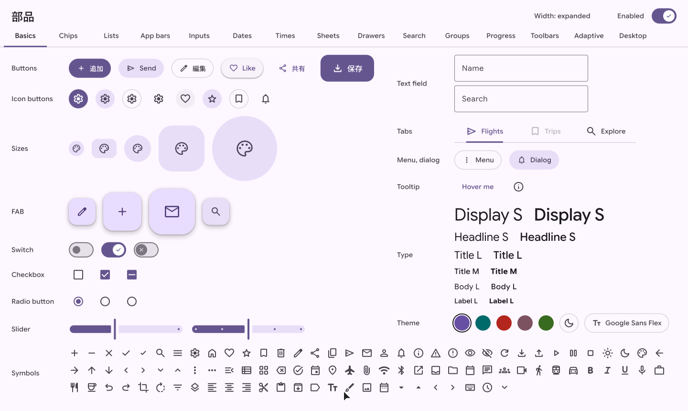
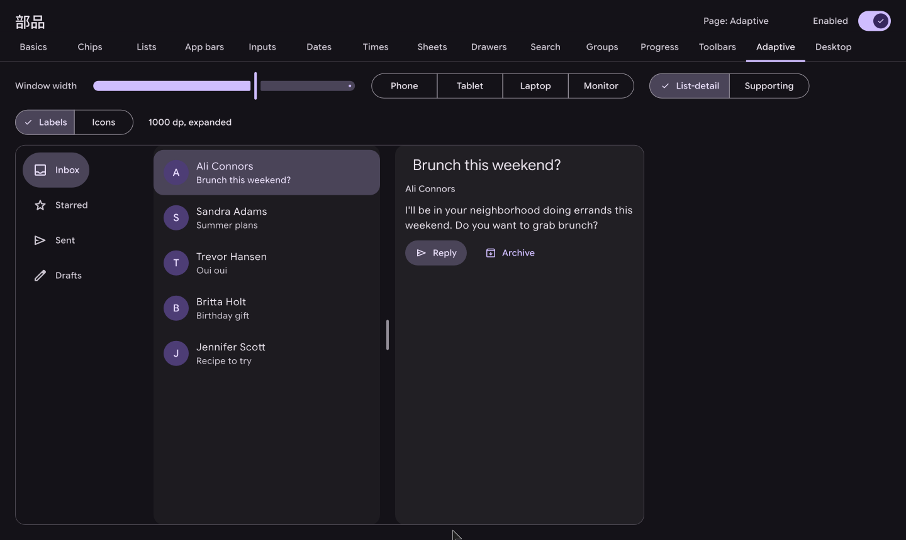

# lamina-ui

[日本語](README.ja.md)

A C++20 desktop UI library modelled on Material 3 Expressive. It draws with ThorVG, shapes text with HarfBuzz and runs in an SDL3 window. The components, token values and motion springs are read from Google's open-source Material 3 implementations.

lamina-ui is not affiliated with or endorsed by Google. "Material Design" is Google's design system; lamina-ui follows its published guidelines and token values.

 

## Status

Version 0.2.0. The API is not stable yet and may change in any 0.x release. It has been built and run only on Windows 11 with Visual Studio 2022; the code for other platforms is written for them but has not been built, and mixed-DPI monitors and Windows 10 have not been tested.

## Quick start

Requires Visual Studio 2022, vcpkg (`VCPKG_ROOT` set), CMake 3.25 or later, and for the examples and tests, which cut icon fonts, Python 3 with fontTools and brotli (`python -m pip install -r tools/icon-subset/requirements.txt`).

```
cmake --preset default
cmake --build --preset release
ctest --preset release
build/Release/components.exe
```

`components.exe` is the gallery of every component, fifteen pages chosen with the tabs under its header. More in [Getting started](docs/getting-started.md) and [Examples](docs/examples.md).

## A minimal program

A window with one button that prints to the console when clicked. Link `lamina::lamina`, `lamina::thorvg` and `lamina::sdl3`; pass a font file on the command line, or let it find a Japanese UI font among the system fonts.

```cpp
#include <cstdio>
#include <memory>

#include "lamina/color/scheme.hpp"
#include "lamina/layout/layout.hpp"
#include "lamina/widgets/button.hpp"
#include "lamina/widgets/nodes.hpp"
#include "lamina/widgets/widget_set.hpp"
#include "lamina_sdl3/app.hpp"
#include "lamina_sdl3/system_fonts.hpp"
#include "lamina_thorvg/canvas.hpp"

using namespace lamina;

int main(int argc, char** argv) {
    const text::FontStack fonts = sdl3::font_stack_from_arguments(argc, argv);
    const color::ColorScheme scheme = color::spec_2025().build(color::default_scheme_options);

    widgets::WidgetSet set;
    auto& hello = set.emplace_with<widgets::Button>(
        [](bool clicked) {
            if (clicked) {
                std::puts("Hello");
            }
        },
        widgets::ButtonOptions{.label = "Say hello"}, fonts);

    auto page = layout::column({widgets::node(hello)});
    page->padding(layout::Insets::all(24.0));

    auto update = [&](const sdl3::Frame& frame) {
        layout::run(*page, {0.0, 0.0, frame.width_dp, frame.height_dp});
        for (const auto& e : frame.pointer) {
            set.handle(e);
        }
        return scheme[color::Role::surface];
    };
    auto paint = [&](render::Canvas& canvas, const sdl3::Frame& frame) {
        set.step(frame.dt_seconds);
        set.paint(canvas, scheme);
        return set.animating();
    };
    sdl3::run_app({"hello", 480, 320}, std::make_unique<thorvg::Canvas>(1, 1), update, paint);
}
```

How the frame loop, input and widgets fit together is in [App structure](docs/app-structure.md).

## Documentation

| Page | What it covers |
| --- | --- |
| [Getting started](docs/getting-started.md) | requirements, build, CMake options, using lamina-ui from another project, embedded icons and fonts |
| [Examples](docs/examples.md) | the gallery and the other examples, and how to run them |
| [App structure](docs/app-structure.md) | targets, the frame loop, input events, the window and canvas, `WidgetSet`, overlays, focus, accessibility, shortcuts |
| [Layout and adaptive layouts](docs/layout-and-adaptive.md) | rows and columns, window size classes, the navigation suite, pane scaffolds, split panes, density |
| [Components](docs/components.md) | actions, selection, inputs, containers, navigation, feedback, menus, the data table, dates and times |
| [Text and fonts](docs/text-and-fonts.md) | shaping and line breaking, typefaces, system fonts, icons, Japanese input |
| [Theming and tokens](docs/theming.md) | color schemes, shape, type, elevation, motion and the spring model |
| [Resources](docs/resources.md) | `lamina_add_resources`, the generated header, embedded icons, files and text fonts |
| [Testing](docs/testing.md) | the unit tests and the offscreen capture of the gallery |
| [Differences from Material 3](docs/differences-from-m3.md) | where lamina-ui uses its own values or behaviour |
| [Design tokens](docs/design-tokens.md) | every value, with its source file and commit |
| [Client-drawn title bar](docs/custom-title-bar.md) | the Windows title bar that lamina draws itself |
| [Android](docs/android.md) | building the gallery as an APK without Gradle, running it, and what works there yet |
| [Renderer comparison](docs/renderer-comparison.md) | why ThorVG and not Blend2D |

## Attribution

The test fonts in `tests/fixtures/fonts/` are subsets of Noto Sans JP and Oswald, renamed, under the SIL Open Font License 1.1 (license files next to them).

`third_party/google-sans-flex/`, `third_party/roboto-flex/` and `third_party/noto-sans-jp/` hold Google Sans Flex, Roboto Flex and Noto Sans JP from [google/fonts](https://github.com/google/fonts), unchanged, under the SIL Open Font License 1.1 (license files there), and programs embed them unchanged. "Google Sans Flex" is a trademark of Google LLC (`third_party/google-sans-flex/TRADEMARKS.md`); lamina-ui is not affiliated with Google.

`third_party/material-symbols/` holds Material Symbols Rounded (variable font) by Google, from [google/material-design-icons](https://github.com/google/material-design-icons) at commit `10ecc14790612ca8fd164e3f4ffe9c16fc50d5b7`, unchanged, under the Apache License 2.0 (`third_party/material-symbols/LICENSE`). The icon fonts embedded in programs are modified versions of it: `lamina_add_resources` cuts them down to the listed symbols, without the ligature table and hinting, and pins the axes asked for; the other variation axes and the name table are kept.

Token values are taken from Google's Apache-2.0 licensed sources: androidx (Jetpack Compose Material 3 and graphics-shapes), material-components-android, material-web and material-color-utilities. The density heights and minimums come from MDC Web (material-components-web, MIT License). See [docs/design-tokens.md](docs/design-tokens.md) for the files and commits.

## License

lamina-ui is licensed under the [Apache License 2.0](LICENSE). See [NOTICE](NOTICE) for the third-party code, fonts and data it includes.
