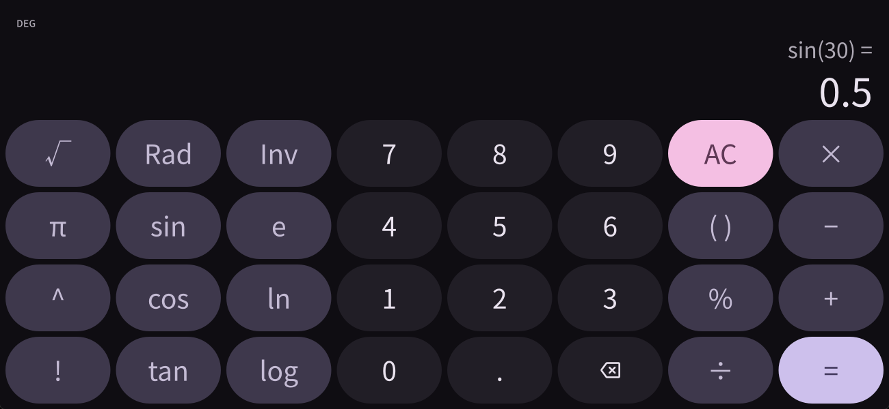
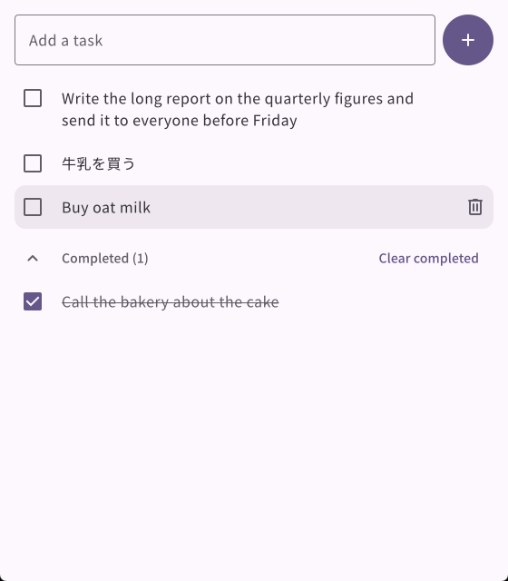

# 見本

[English](examples.md) · [README](../README.ja.md#資料)

見本はどれも `build/Release/` にビルドされ、どのフォルダーからでもそれだけで動きます。

## 動かし方

`build/Release/playground.exe [フォントのファイル...]` を開くと、カードが 6 枚並んだ窓が出ます。カードをクリックすると、浮き上がり・角の丸みの増加・色の変化が、それぞれ expressive の体系のばねで動きます。

見本はそれぞれ使うアイコン（`CMakeLists.txt` に書いています）を埋め込んでいるので、`.exe` だけでどのフォルダーからでも動きます。

`shapes_gallery.exe` 以外の見本は、コマンドラインでフォントのファイルを受け取ります（例：`buttons.exe C:/path/to/font.ttf`）。後ろのファイルは、前のファイルに無い文字を補います。指定しないときは、OS のフォントから最初に見つかった日本語の画面向けのフォントを使い（`lamina_sdl3/system_fonts.hpp`）、一つも無ければ、試したパスを並べたエラーを出して終わります。components の見本は、代わりに同梱の文字のフォントを埋め込み、Google Sans Flex と Noto Sans JP で始まります。`--font roboto-flex` か `--font os` でほかの書体で始まり、Basics のページのテーマの行にあるフォントのボタンで、動いている間に書体を切り替えられます。

見本はそれぞれ一つの `examples/<名前>/main.cpp` で（電卓・タイマー・ToDo リストは、しくみ・配置・表示のコードを、部品の一覧は一覧と記録の道具を同じフォルダーに置いています）、`sdl3::run_app` で繰り返しを回し、部品があればそれを `widgets::WidgetSet` でまとめて進めて描きます（遊び場と形の一覧は部品を使わず、値を直接動かします）。ToDo リストは、行を行だけの `widgets::WidgetSet` に持ちます。タスクが増えるとセットの中に行を作り、消えていく動きが終わった行はセットから外します。セットは各行にポインターの出来事を渡して行の受け手を呼び、行は `for_each` で三回に分けて描きます（消えていく行、止まっている行、最後に動いている行を上に）。また、ダイアログとスナックバーへの入力を `widgets::OverlayStack` で振り分け、Tab の順番を `widgets::FocusManager` で決め、`widgets::ScrollArea` で送ります。ナビゲーションの例はメニューとダイアログへの入力を `widgets::OverlayStack` で振り分け、入力欄と配置の例は `widgets::FocusManager` でフォーカスを移し、IME の位置を決め、カーソルの点滅のために起こします。複数の見本で使うコードは `examples/common/`（`lamina_examples_common` ライブラリ、名前空間 `lamina::examples`）にあります。`window_canvas` は見本の窓が描く先の ThorVG の描画面を作り、`caption_cell` は行の横に見出しを置き、`ThemeFade` は今の配色から新しい配色へ、遅い効果のばねで移り変わらせます。`SeedChips` は元の色の丸を並べ、選んだものに輪を付け、新しく選ばれた色を知らせます。`AnimatedBox`（`animated_box.hpp`）は、四角形をばねで動かし、新しい場所へ移るか、そのまま合わせるかを選べます。電卓とタイマーのキーがこれを使います。

## Components（部品の一覧）

`build/Release/components.exe` は、部品をあらゆる状態で並べた一覧です。見出しの下の、横に送れる二次タブで十六のページを切り替えます。指で横になぞっても送れます。Basics：アイコンつきのボタン・ツールチップつきのアイコンボタン・FAB・スイッチ・チェックボックス・ラジオボタン・スライダー・薄い案内の文字（プレースホルダー）つきの入力欄・無効なタブを含むタブ・無効な項目を含むメニュー・中身がスクロールするダイアログ・簡素なツールチップと詳しいツールチップ・標準と強調の文字・アイコンを並べます。テーマの切り替えはボタンの例と同じです。Chips：アシストと提案のチップ（平ら・浮いた・無効）、フィルターチップの組（チェックの印つきで選ばれたもの・先頭のアイコンがチェックの印に替わるもの・浮いたもの・無効なもの）、入力チップの組（アバター・先頭のアイコン・外すボタン・無効なチップ）、一つだけ選べて折り返すチップの組、押せる浮いた・塗った・枠線のカード（一つは中にテキストボタンを持ちます）、押せないカード、無効なカード二つ、端まで・両端を空けた・縦の区切り線。Lists：設定のリスト（スイッチ・末尾の文字つきのアバター・小見出しつきの画像・チェックボックス・ラジオボタン・無効な行・末尾のアイコン・操作のない行）、枠線のカードに入れた三つのリストの項目と両端を空けた区切り線、10,000 行のリスト。App bars：トップアプリバーの下にリストを置いた枠四つ（小さく固定・中央そろえで `enter_always`・中くらいで `exit_until_collapsed`・大きい伸縮するもので副題つき・`exit_until_collapsed`）、点・数・999+ のバッジつきのアイコンボタン、数を変えるボタン、同じバッジを項目に付けたナビゲーションバーとレール。Inputs：セグメントボタン（一つだけ選ぶもの・アイコンつき・いくつでも選べるもの・アイコンだけ・無効な区画・無効な行）、範囲スライダー（値の表示つき・段つき・無効）、スライダーの新しい形（中央から塗るもの・角 4 dp のトラック・目盛りの上の値の表示・縦の三本）。Dates：ロケールの切り替え（English (US)・English (UK)・日本語）の下に、平日だけを選べるその場の日付の選択、期間の選択、入力欄の下に開くもの、日付と期間のダイアログを開くボタン。Times：ロケールと 12 時間制・24 時間制の切り替えの下に、縦の文字盤・横の文字盤・入力の時刻の選択と、モードの切り替えつきの時刻のダイアログを開くボタン。後の三つのページは、画面のパターンをそれぞれ小さなアプリの入ったスマートフォンか小さな窓の大きさの枠に置きます。Sheets：ボタンで開く操作の一覧のモーダルなボトムシート、128 dp だけのぞく場所の一覧のモーダルでないボトムシート、窓の端に付けたモーダルなサイドシート・端から離したもの・アプリの文章の横に場所を取るモーダルでないものを開くボタンを置いた枠。Drawers：メニューのボタンか枠の上を右へのドラッグで開くモーダルなドロワー、アプリを横へ押しやる閉じられるドロワーとそれを常に出ているドロワーに変えるスイッチ、メニューのボタンで広がるモーダルな幅の広いナビゲーションレールと畳むと隠れる形に変えるボタン。Search：412 dp の枠で全画面の表示に広がる検索バーと、900 dp の枠でバーの下に開く表示に広がる検索バー（小さい幅の窓で枠が 600 dp より狭くても、いつもバーの下に開きます）。どちらも検索語が変わるたびに都市の一覧を絞り込みます。Groups：ふつうの・つながった・はみ出す・無効なボタンの組、五つの大きさとほかの三つの形の分割ボタン、畳む切り替えつきの拡張 FAB。Progress：まず、進み具合のある表示が示す値を決めるスライダー、それを少しずつ満たす Run のボタン、一組を進み具合のあるものとないものの間で切り替えるスイッチ。そのあとに、ふつうの・入れ物のある・進み具合のある・大きな読み込み中の表示、進み具合のあるものとないものの直線と円の波のある表示、指で下に引っ張って更新するリストの入ったスマートフォンの大きさの枠（更新は 1.5 秒かかり、上に行を一つ足します。上の Arrow indicator のスイッチで、Expressive の表示を昔ながらの矢印と回る円に切り替えます）。Toolbars：スマートフォンの大きさの三つの枠に、FAB の中へ畳まれる浮かぶツールバー、vibrant の縦のツールバーと前後に中身のある横のツールバー（どれもスクロールで畳みます）、FAB メニューの下でスクロールすると退く柔軟な下のアプリバー。Adaptive：スライダーと四つの決まった幅で幅を決める見立てのウィンドウに、メールのアプリを置いています。幅の区分が変わるとバーからアイコンだけのレール、広げたレール、ドロワーへ変わるナビゲーションスイートの足場（横の並びをアイコンだけにたたむ Labels と Icons の選択つき）の上に、ペインの広さを変えるドラッグハンドルつきのリストと詳細の足場か、補助のペインの足場があります。Desktop：同じ部品を密度 0・-1・-2・-3 で並べたものと、素材の一覧・プレビュー・数値欄のインスペクター・縦横にスクロールするタイムラインを入れ子の分割ペインで組んだ編集画面と、メニューバー・10 万件のファイルの表・行のコンテキストメニュー・状態の行を持つファイルの管理の画面（Files）。Files のメニュー・コンテキストメニュー・キーは一つのショートカットの登録簿を共有します。Viewer：タイル・輪・細かい格子・四隅の点を描いた模様の拡大の表示。二本の指でつまんで広げたり動かしたりでき、拡大しているときは一本の指で動かせます。二度たたくかダブルクリックすると拡大と元に戻すを切り替え、Ctrl を押しながらホイールを回すとカーソルを中心に拡大します。Fit のボタンで収まる大きさに戻ります。その下には、三つの形の描いた写真十二枚のページ送りがあり、どの写真も拡大の表示です。なぞると次の写真へ送り、拡大した写真は端まで動いてからなぞりをページ送りに渡し、最初の写真より前へなぞると見本の前のページへ移り、状態の行に写真の番号を出します。倍率は動きが止まったときに状態の行に出ます。上の Enabled のスイッチで、すべてのページの操作部品を無効にしたり戻したりできます。見えていないページの部品は、入力もフォーカスも受けず、読み上げ用の木にも入りません。

ページは、窓の今の幅から求めた窓の大きさの区分（`sdl3::Frame::size_class`）に従って並びます。expanded（840 dp）より狭いと、どのページも一列で、右側の列の区画は左側の列の区画の下に続きます。expanded 以上では列を横に並べます。収まるときはそれぞれの列が本来の幅を取り、収まらないときはいちばん広い列から幅を譲ります。compact（600 dp 未満）の窓では、行の見出しを中身の横ではなく上に置きます。ボタン・チップ・カード・枠などが並ぶ行は、使える幅で折り返します（`layout::flow`）。ページが決めている幅（スライダー・リスト・枠など）は、場所が足りなければその場所まで縮みます。窓が区分の境目をまたいだときや行の折り返し方が変わったときは、区画・見出し・項目がそれぞれ今の位置から新しい位置へ、既定の空間のばねで滑ります（`examples/components/reflow.hpp` の `Reflow`・`Columns`・`Captioned`）。それ以外のときは窓にそのまま付いていきます。ページや Desktop のページの表示を切り替えたときは、滑らずにその場に置きます。窓より高いページはホイールかスクロールバーで縦にスクロールでき、Tab でフォーカスが移った部品は見える位置までスクロールします。見出しの右には、一覧を開いたときと区分が変わったときに、窓の幅の区分（Width: compact など）を出します。Adaptive のページの仮の窓はページに使える幅より広くならず、スライダーで変えたときは仮の窓の区分を Frame: … と出します。セグメントボタンの行と分割ボタンは使える幅を分け合い、収まらない文字は「…」で切ります。横向きの時刻ピッカー（508 dp）は狭くできないので、窓のほうが狭いときはカードの中で横にスクロールします（`examples/components/side_scroll.hpp`）。Shift を押してホイールを回すか、スクロールバーを使うか、フォーカスを中へ移すと動きます。

Tab と Shift+Tab で、Enabled のスイッチとページのタブのあと、そのページのすべての操作部品を読む順にたどれます（ページごとの `FocusManager`）。フォーカスのある部品は、Space か Enter でクリックと同じように動きます。色の丸（`examples/common/theme.hpp`）は、ラジオボタンの組と同じく一つの止まり位置です。左右の矢印で前後の色を選び（端では反対の端へ戻ります）、`Home` と `End` で最初と最後の色を選びます。輪は選んだ丸の周りに出ます。ボタンの例はキーを受けません。

`build/Release/components_capture.exe` は同じ一覧を窓なしで描きます。[テスト](testing.ja.md#窓なしの記録)を見てください。

## 電卓

`build/Release/calculator.exe` は電卓です。部品を並べて見せるのではなく、アプリとして使うための最初の見本で、縦長と横長の配置は Android の電卓に倣っています。計算のしくみは `calculator_engine` ライブラリにあり、lamina-ui のどこも使いません。`examples/calculator/engine.hpp` が命令を受け取り、表示する文字列を返します（テストは `tests/calculator_engine_test.cpp`）。式は数・定数・演算子・関数・かっこの並びで、再帰下降で計算します。`^` がいちばん強く右から結び付き、次に × と ÷、次に + と − の順で、表示される式のとおりになります。`( )` のキーはかっこを開き、数などを入れたあとなら閉じます。開いたままのかっこは `=` で閉じ、入れ終えた数などのすぐあとの数・定数・関数・かっこはかけ算になります。最初・`(` のあと・×、÷、^ のあとの − は、負の数の始まりになります。`=` を続けて押すと、最後の演算子と数をもう一度使います。パーセントは x/100 で、+ と − のあとでは、同じかっこの中でその左にある値に対する割合です。関数のキーは sin・cos・tan（度で計算し、`Rad`/`Deg` のキーで弧度法に切り替えます。単位は表示部に出ます）・ln・log・√・π・e・`^`・`!` です。`Inv` を押すと、もう一度押すまで、sin・cos・tan・ln・log・√ が asin・acos・atan・e^x・10^x・x² になり、キーには使う名前が出ます。結果は `double` で計算し、一回ごとに有効数字 15 桁に丸めます（三角関数の結果が 10⁻¹² 未満なら 0 にするので、sin 180° は 0 です）。表示は有効数字 12 桁で、3 桁ごとに区切り、10⁻⁶ 未満と 10¹² 以上は指数の形にします。一つの数に入力できるのは 12 桁までです。0 で割ったとき、`double` の範囲を超えたとき、関数の定義域の外の値（負の数の平方根や対数、tan 90°、整数でない数の階乗）のときは、数字かクリアを押すまで知らせの文を表示します。キーの置き場所は、同じライブラリの `examples/calculator/keypad_layout.hpp` が決めます（テストは `tests/calculator_layout_test.cpp`）。縦長では丸いキーが 4 × 5 個並び、直径は幅から 8 dp の間を引いて 4 で割った値です。ただし表示部に 160 dp を残せないときは高さで直径を決め、キーの並びは中央に置きます。窓の幅が高さの 1.2 倍以上になると横長の配置に切り替わり、幅が高さ以下になると縦長に戻ります。その間では今の配置のままなので、境目の近くで枠をドラッグしても配置が行き来しません。横長は 4 行で、数字の 3 列、AC・( )・%・÷ の列、×・−・+・= の列が並びます。キーは高さの許す限り高い楕円で、幅は高さの 1.75 倍までです（参考にした画面では、これより横に長いキーは押しにくく見えました）。その上限を超える幅は使わず、キーの並びを中央に置きます。8 列にしても各キーの幅が高さの 1.4 倍以上になるときは、左に関数のキーの 3 列が現れ、1.2 倍を下回ると消えます。切り替わるたびに、各キーは標準の空間のばねで新しい場所へ動き、関数のキーは標準の効果のばねで現れたり消えたりし、表示部はキーの並びの幅についていきます。配置が変わらない間は、キーは窓の大きさにそのまま合わせます。窓の側は薄い殻です。`main.cpp` は、キー（ラベル・役割・両方の配置での位置）・色の役割・キーボードの割り当て・比率を一つの `Config` にまとめています。キーは `ButtonSize::extra_large` のボタンを `set_size` で大きさを決めたものです。数字・小数点・一文字消すは `surface_container_high`、演算子と関数のキーは `secondary_container`、AC は `tertiary_container`、`=` は `primary` の色です（`ButtonOptions::colors`）。ラベルはキーの高さの 40 %、アイコンは 36 % の大きさです（`set_content_scale`）。押すと、角の丸い四角へ形が変わります。キーボードで打ったキーも、同じようにそのボタンを 0.12 秒押します（中央でポインターを押し、`cancel_interaction` で戻します）。表示部（`examples/calculator/display.hpp`）は、式と結果を下のほうに右寄せで表示します。注目している行（入力中は式、`=` のあとは結果）は Display L、もう一方は Headline L で、二つは標準の空間のばねで大きさを、遅い効果のばねで色を入れ替えます。幅に収まらない行は 45 % まで連続して縮み、それより長ければ先頭が切れます。配色は暗い配色です。キーボードでは、数字・`+ - * /`・`^`・`!`・`( )`・`.`・`%`・Enter か `=`・Backspace・Escape（最後の数を消し、もう一度で全部消す）・Delete（全部消す）が使えます。キーは Tab のフォーカスを受けません。どのキーにも対応するキーボードのキーがすでにあり、ここでは Enter が = なので、フォーカスがあると Enter の意味が二通りになってしまうためです。

## タイマー

`build/Release/timer.exe` はタイマーで、アプリとしての二つ目の見本です。参考にした Android の時計アプリのタイマーからは、作りだけを借りています。タイマーは一つで、窓にそのまま描き、周りにカードを置かず、色は配色の役割だけを使います。動きのしくみは `timer_engine` ライブラリにあり、lamina-ui のどこも使いません（`examples/timer/engine.hpp`。テストは `tests/timer_engine_test.cpp`）。Android と同じく、数字は時:分:秒の右から入ります（先頭の 0 と 00 は無視し、6 桁まで。一文字消すと最後の数字が消えます）。始めるときに各欄を繰り上げるので、90 秒は 01:30 として進みます。タイマーは進む・止める・再開する・1 分足す（終わったあとなら 1 分からもう一度始めます）・空の入力に戻す、ができ、0 になると超過した時間をマイナス付きで数えます。しくみの側は時計を読みません。どの呼び出しも今の時刻を受け取るので、テストは正確に決まります。残りの時間は切り上げ、超過は切り捨てて表示するので、終わった瞬間は 00:00、その 1 秒後に −00:01 になります。同じライブラリの `examples/timer/layout.hpp`（テストは `tests/timer_layout_test.cpp`）が、縦長と横長で二つの画面の置き場所を決めます。切り替えは電卓と同じく、幅が高さの 1.2 倍以上で横長、1.0 倍以下で縦長に戻り、その間は今の配置のままです。切り替わると、キーは標準の空間のばねで新しい場所へ動きます（`examples::AnimatedBox`）。入力の画面には、表示部・四つの定番の時間（1m・5m・10m・15m。`secondary_container` の色で、押すと入力をその時間にします）・丸いキーの 3 × 4 の並び（1〜9・00・0・一文字消す。電卓と同じキー）・開始のキー（`primary` の色に塗りつぶしの再生のアイコン）があり、横長ではキーの並びが右に来ます。表示部（`examples/timer/readout.hpp`）は時・分・秒を小さな単位の文字付きで表示します。まだ入力していない桁は `outline_variant`、入力した桁は `on_surface` の色で、桁ごとに標準の効果のばねで色が移ります。開始のキーは、時間を入れると標準の空間のばねで中心から大きくなって現れ、消すと小さくなって消えます。進行中の画面は、窓の大きさに合わせた輪（`CircularProgressIndicator`。太さ 10 dp、振幅 3 dp・波長 42 dp の波）を中央に置き、その中に時間と、時間の下に一時停止のキーを置きます。1 分足すのキーと戻すキーは、縦長では輪の下に、横長では輪の横に置きます。輪はフレームごとに残りの時間に合わせ、1 分足したときは新しい割合へなめらかに移ります。数字は同じ幅の枠に一つずつ置くので、数えている間に時間の文字が横にずれません。一時停止のキーは、進行中は一時停止のアイコンの四角、止めている間は再生のアイコンの円です（`Button::set_shape`・`set_icon`）。時間になると、輪の色は `error` と `error_container` に、時間の文字は `error` に移り、止めるまで輪と時間とキーがゆっくり脈打ちます。二つの画面は、遅い効果のばねで入れ替わりながら、遅い空間のばねで 0.92 倍と 1 倍の間を拡大縮小し、隠れている画面は入力を受け取りません。窓が描き続けるのは、タイマーが進んでいるとき、終わったあと、何かが動いているときだけで、入力の画面と一時停止の間は入力を待ちます。キーボードでは、入力の画面で数字と Backspace、Enter かスペースで開始・一時停止・再開・停止、Escape で戻す（入力の画面では入力を消す）が使えます。Tab と Shift+Tab で、いま見えている画面のボタン（プリセット・数字・開始、または一時停止・+1:00・戻す）をたどれます。開始ボタンは隠れている間は飛ばします。フォーカスのあるボタンでは、Space や Enter は開始や一時停止ではなくそのボタンを押すので、一つのキーで両方が起きることはありません。ボタンにフォーカスがあるまま画面が切り替わると、フォーカスは新しい画面の最初のボタンに移ります。

## ToDo リスト

`build/Release/todo.exe` は ToDo リストで、アプリとしての三つ目の見本です。Google ToDo リストを手本にしつつ、PC の窓で使いやすいようにしています。上に入力の行、その下にタスクを並べ、窓にそのまま描いてカードは置きません。動きのしくみは `todo_engine` ライブラリにあり、lamina-ui のどこも使いません（`examples/todo/engine.hpp`。テストは `tests/todo_engine_test.cpp`）。タスクは ID・文字・済みかどうか・作った順番を持ちます。リストは、追加（いちばん上へ）・書き換え・チェックとその解除・削除・並べ替え・完了したタスクの一括削除・最後の削除か一括削除の取り消し（一段だけ）ができ、窓が保存の時機を知るための変更の番号を数えます。文字は受け取るときに整えます。改行などの制御文字は空白にし、前後の空白を除き、UTF-8 として正しくない並びは U+FFFD に置き換え、空の文字は受け付けません。ファイルはタスク一つにつき UTF-8 の一行で、`[ ] 文字` か `[x] 文字` です。読み込みでは空の行とバイト順マークを飛ばし、`[X]` と CRLF も受け付けます。印のない行は未完了のタスクとして残し、印だけで文字のない行は捨て、そうした行を行番号とともに知らせます。窓はそれを標準エラーに出します。変更のたびに、リストを `sdl3::preference_directory("lamina-ui", "todo")`（Windows では `%APPDATA%\lamina-ui\todo\`）の `todo.txt` に保存します。まず `todo.txt.new` に書き、それを古いファイルに置き換える名前に変えます（`examples/todo/storage.hpp`）。保存に失敗したときは標準エラーに出し、リストはメモリーに残ります。ほかの場所には何も書きません。`--data-dir <フォルダー>` を付けると、そのフォルダーの `todo.txt` を読み書きします。フォルダーが無ければ作ります。試しに動かすときに、ふだん使っているリストに触れないためのものです。同じライブラリの `examples/todo/layout.hpp`（テストは `tests/todo_layout_test.cpp`）は、入力の行と、幅が最大 640 dp の列を中央に置きます。そのため広い窓でも行は横に伸びません。リストは入力の行より下の窓いっぱいの `ScrollArea` の中で送るので、スクロールバーは窓の端に出ます。列の幅は窓の幅になめらかに従うので、横長のときに切り替える配置はありません。行（`examples/todo/row.hpp`）は、チェックボックス、列の幅で折り返す文字（Body L）、削除のアイコンボタンでできています。削除のボタンは、ポインターが行の上にあるときか行にフォーカスがあるときに現れます。見えていないときも場所を取るので、そのために行の高さが変わることはありません。済んだタスクの文字は `on_surface_variant` の色へ薄くなり、薄くなるのに合わせて各行に取り消し線が伸びます。文字をクリックすると、その場に枠線つきの入力欄が出ます。文字と入れ替わるように現れ、行は入力欄が収まる高さに伸びます。Enter で新しい文字を残し、Escape で元に戻し、ほかの場所をクリックしたときは Google ToDo リストと同じく新しい文字を残します。書き換えの途中で窓を閉じたときも残します。済んだタスクは、未完了のタスクの下の「Completed (n)」の欄に移ります。その見出しで欄を畳むことができ、山形の印は標準の空間のばねで向きを変えます。見出しのテキストボタン「Clear completed」は、先にダイアログで確かめます。行は標準の空間のばねで新しい場所へ動きます。新しい行は高さ 0 から伸びながら現れ、消した行は縮みながら消え、その下の行も同じばねでついて行くので、何も跳びません。削除と一括削除のあとには取り消し（Undo）のついたスナックバーが出ます。Ctrl+Z でも取り消せます。入力欄か書き換え中の行の文字にフォーカスがある間は、Ctrl+Z はまずその欄で打った文字を取り消し、Ctrl+Shift+Z と Ctrl+Y はそれをやり直します。欄に取り消すものが残っていないときの Ctrl+Z だけがリストの取り消しに届くので（`TextField::handles_history_key`）、一度のキーで両方が動くことはありません。Ctrl+Shift+Z と Ctrl+Y でリストが取り消されることもありません。押し続けて繰り返し届く Ctrl+Z もリストを取り消さないので、欄で Ctrl+Z を押し続けても、欄の履歴が尽きたところで止まります。リストが空のときは、真ん中に `task_alt` のアイコンと短い言葉を出します。キーボード：Enter で追加し、フォーカスは入力欄に残ります。Tab と Shift+Tab で、入力欄、追加ボタン、各行のチェックボックス・文字・削除ボタン、完了の欄の見出しの折りたたみと「Clear completed」、最後に表示中のスナックバーの Undo を、並んでいる順にたどれます（`FocusManager`）。入力欄から ↓、行どうしでは ↑ と ↓ で、行の文字の間を移ることもできます。フォーカスのある追加ボタン・削除ボタン・「Clear completed」は Space か Enter で押せ、チェックボックスは Space でチェックできます。行の文字にフォーカスがあるときは、Space でチェック、Enter で書き換え、Delete で削除、Ctrl+↑ と Ctrl+↓ で欄の中での並べ替えができます。Escape では、行のどの部分からでも入力欄に戻ります。Page Up と Page Down で送ります。キーボードでタスクをチェックしたり削除したりすると、フォーカスは次の行の同じ部分に移ります。削除ボタンは、その行のどこかにフォーカスがある間は見えています。チェックボックスと削除ボタンは M3 のフォーカスの輪を描きます。行が止まっている間は、輪が行の切り抜きからはみ出して描かれます。行の文字のフォーカスは、行どうしが接しているので、これまで通り行の内側の 2 dp の輪で示します。フォーカスのある折りたたみで Space か Enter を押すと、欄を畳んだり開いたりします。折りたたみは、行の文字と同じく、フォーカスの状態の重ねと縁の内側の輪を描きます。Undo にフォーカスがある間はスナックバーは消えず、Space か Enter で取り消して、フォーカスを入力欄に戻します。「Clear completed」のダイアログは、開いている間フォーカスを持ちます（最初は Cancel。キーボードで開いたときはすぐに輪が見えます）。Tab は Cancel と Delete の間だけを移り、キーボードで閉じるとフォーカスは「Clear completed」に戻ります。ただし、そのボタンがまだあるときに限ります（`OverlayStack::set_focus`）。ポインターで閉じたときは、どこにもフォーカスを残しません。何も動いていない間、窓はイベントを待って止まります。カーソルの点滅・スクロールバーが消える時刻・スナックバーの時間は、`wake_after` で窓を起こします。
