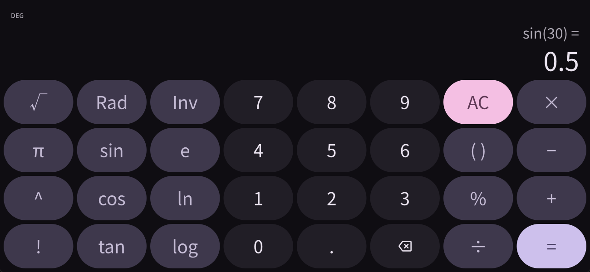
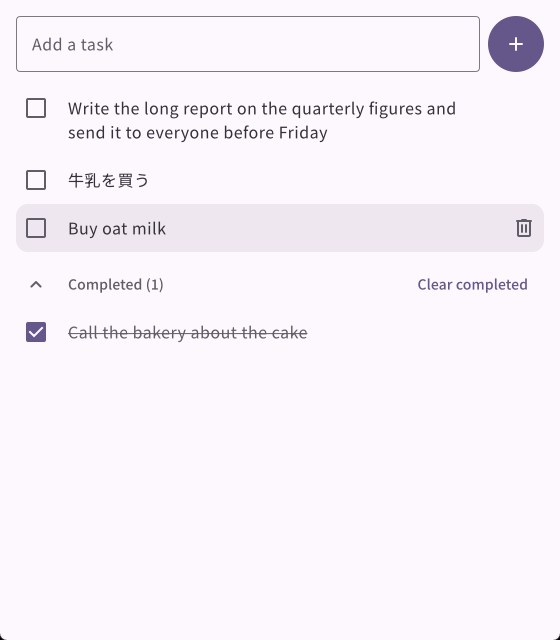

# Examples

[日本語](examples.ja.md) · [README](../README.md#documentation)

Every example is built into `build/Release/` and runs alone from any folder.

## Running them

`build/Release/playground.exe [font files...]` opens a window with six cards. Clicking a card raises it, rounds its corners further and changes its color, each driven by a spring of the expressive motion scheme.

Each example embeds the icons it uses (listed in `CMakeLists.txt`), so its `.exe` runs alone from any folder.

Every example except `shapes_gallery.exe` takes font files on the command line, for example `buttons.exe C:/path/to/font.ttf`; later files fill in characters the earlier ones lack. Without arguments, an example uses the first Japanese UI font it finds among the system fonts (`lamina_sdl3/system_fonts.hpp`), and exits with an error that lists the paths it tried if there is none. The components example embeds the bundled text fonts instead and starts in Google Sans Flex with Noto Sans JP; `--font roboto-flex` or `--font os` starts it in another typeface, and the font button in the Basics page's theme row switches the typeface while it runs.

Each example is one `examples/<name>/main.cpp` (the calculator, the timer and the to-do list keep their engine, layout and view code beside it, and the components example its gallery and the capture tool) that runs its loop with `sdl3::run_app` and, when it has widgets, steps and paints them through `widgets::WidgetSet` (the playground and the shapes gallery animate plain values instead). The to-do list keeps its rows in a `widgets::WidgetSet` of their own, built in the set as tasks come and removed from it once their leaving animation ends; the set gives each row the pointer events and runs the row's handler, and paints the rows in three passes with `for_each` (leaving rows, resting rows, then moving rows on top). It routes its dialog and snackbar through `widgets::OverlayStack`, its Tab order through `widgets::FocusManager`, and scrolls with `widgets::ScrollArea`. The navigation example routes its menus and dialogs through `widgets::OverlayStack`; the text field and layout examples cycle the focus, place the IME and wake the caret blink through `widgets::FocusManager`. Code that several examples share is in `examples/common/` (the `lamina_examples_common` library, namespace `lamina::examples`): `window_canvas` makes the ThorVG canvas the examples' windows draw on, `caption_cell` places a caption beside a row, `ThemeFade` cross-fades from the current scheme to a new one on the slow effects spring, `SeedChips` draws the seed color chips, rings the chosen one and reports a newly chosen seed, and `AnimatedBox` (`animated_box.hpp`) moves a rectangle on springs, gliding to a new place or following directly, for the calculator's and the timer's keys.

## Components

`build/Release/components.exe` is a gallery of the components in every state, on sixteen pages chosen by the scrollable secondary tabs under its header. Basics: buttons with icons, icon buttons with tooltips, FABs, switches, checkboxes, radio buttons, sliders, text fields with placeholders, tabs with a disabled tab, a menu with a disabled item, a dialog with scrolling content, plain and rich tooltips, the standard and emphasized type, the icons, and the theme chips of the buttons example. Chips: assist and suggestion chips (flat, elevated, disabled), a filter chip group (selected with a checkmark, a leading icon swapped for the checkmark, elevated, disabled), an input chip group (avatars, a leading icon, remove buttons, a disabled chip), a single-selection chip group that wraps, clickable elevated, filled and outlined cards (one with a text button inside), a non-clickable card, two disabled cards, and full-bleed, inset and vertical dividers. Lists: a settings list view (switch, avatar with trailing text, image with an overline, checkboxes, radio buttons, a disabled row, a trailing icon, a row without an action), three list items with inset dividers in an outlined card, and a list view of 10,000 rows. App bars: four frames, each a list view under a top app bar (small and pinned, center-aligned and enter-always, medium and exit-until-collapsed, large flexible with a subtitle and exit-until-collapsed), icon buttons with a dot, a count and 999+, buttons that change the count, and a navigation bar and rail whose items carry the same badges. Inputs: segmented buttons (single choice, with icons, multiple choice, icons only, a disabled segment and a disabled row), range sliders (with value indicators, with steps, disabled) and the new forms of the slider (centered, a 4 dp track corner, a value indicator over ticks, and three vertical sliders). Dates: a locale switch (English (US), English (UK), Japanese) above an inline date picker that allows weekdays only, a range picker, a docked picker and buttons that open the date and range dialogs. Times: a locale and a 12- or 24-hour switch above a vertical dial picker, a horizontal one, an input one and a button that opens the time dialog with its mode toggle. The last three pages put each pattern in a frame the size of a phone or a small window, with a little app inside. Sheets: a modal bottom sheet of actions opened by a button, a standard bottom sheet of places that peeks 128 dp, and a frame with buttons for a docked modal side sheet, a detached one and a standard one that takes room beside the app's text. Drawers: a modal drawer opened by the menu button or a drag to the right across the frame, a dismissible drawer that pushes the app aside with a switch that turns it into a permanent drawer, and a modal wide navigation rail whose menu button expands it, with a button for the form that hides on collapse. Search: a search bar in a 412 dp frame, which expands into the full-screen view, and one in a 900 dp frame, which always expands into the docked view, also when the frame is narrower than 600 dp on a compact window, both filtering a list of cities as the query changes. Groups: standard, connected, overflowing and disabled button groups, split buttons in five sizes and three more styles, and extended FABs with a collapse toggle. Progress: first a slider that sets the value the determinate indicators show, a Run button that fills them step by step and a switch that turns a pair between determinate and indeterminate, then plain, contained, determinate and large loading indicators and determinate and indeterminate linear and circular wavy progress indicators. Toolbars: three phone frames with a floating toolbar that folds into its FAB, a vibrant vertical toolbar and a horizontal one with side content, all collapsing on scroll, and a flexible bottom app bar that exits on scroll under a FAB menu. Adaptive: a simulated window whose width a slider and four presets set, with a mail app inside: a navigation suite scaffold that turns from a bar into an icon-only rail, an expanded rail and a drawer as the width class changes, with a Labels and Icons choice that collapses the side list to its icons, over a list-detail scaffold with the pane expansion drag handle or a supporting-pane scaffold. Desktop: the same components at densities 0, -1, -2 and -3 side by side, an editor of nested split panes with an asset list, a preview, an inspector of numeric fields and a timeline that scrolls in both directions, and a file manager (Files) with a menu bar, a table of 100,000 files, a context menu on its rows and a status line, whose menus, context menu and keys share one shortcut registry. Viewer: a zoom view over a drawn pattern of tiles, rings, a fine grid and corner dots, which two fingers pinch and pan, one finger pans while zoomed, a double tap or a double click zooms in and out, and Ctrl with the wheel zooms about the cursor, with a Fit button that fits it again; the status line shows the scale once it settles. The Enabled switch in its header disables every control on every page and enables it again; widgets on the pages not shown take no input, focus or accessibility nodes.

The pages follow the window size class of the window's current width (`sdl3::Frame::size_class`). Below expanded (840 dp) every page is one column, with the sections of its right-hand columns below those of its left; from expanded on, the columns stand side by side, at their natural widths when they fit and otherwise giving up width from the widest column first. On a compact window (below 600 dp) a row's caption sits above its content instead of beside it. Rows of items (buttons, chips, cards, frames and so on) wrap to the width there is (`layout::flow`), and the widths a page sets (a slider's, a list's, a frame's) shrink to the room when there is less. When the window crosses a breakpoint or a row wraps differently, every section, caption and item glides from where it was to its new place on the default spatial spring (`examples/components/reflow.hpp`: `Reflow`, `Columns`, `Captioned`); otherwise it follows the window directly, and switching pages or the Desktop page's views places everything at once. A page taller than the window scrolls with the wheel or its scroll bar, and a control that Tab moves the focus to is scrolled into view. The header shows the window's width class (Width: compact and so on) when the gallery starts and whenever the class changes. The Adaptive page's simulated window is at most as wide as the room on the page, and its slider reports the frame's class as Frame: … . The segmented rows and split buttons share the width there is, cutting labels that do not fit with an ellipsis. The horizontal time picker (508 dp) cannot narrow, so when the window is narrower it scrolls sideways inside its card (`examples/components/side_scroll.hpp`): with shift and the wheel, its scroll bar, or by moving the focus into it.

Tab and Shift+Tab go through every control of the page in reading order, after the Enabled switch and the page tabs (one `FocusManager` per page), and Space or Enter works the focused one as a click does. The seed chips (`examples/common/theme.hpp`) are one stop, as a radio group is: Left and Right pick the previous or next color, wrapping, Home and End the first and last, and the ring goes around the chosen chip. The buttons example takes no keys.

`build/Release/components_capture.exe` renders the same gallery without a window; see [Testing](testing.md#offscreen-capture).

## Calculator

`build/Release/calculator.exe` is a calculator, the first example meant to be used as an app rather than to show components; its layouts follow the Android calculator in portrait and in landscape. Its logic is in the `calculator_engine` library, which uses no part of lamina-ui. `examples/calculator/engine.hpp` takes commands and returns the display strings (tests in `tests/calculator_engine_test.cpp`). The expression is a list of numbers, constants, operators, functions and parentheses, evaluated by recursive descent: `^` binds tightest and to the right, then × and ÷, then + and −, as the display shows it. The `( )` key opens a group, or closes one after a complete operand; groups left open close on `=`, and a number, constant, function or group right after a complete operand multiplies it. Minus at the start, after `(` and after ×, ÷ or ^ starts a negative number. A repeated `=` applies the last operator and operand again; percent is x/100, and after + or − it is that share of the value to its left within the same group. The scientific keys add sin, cos and tan (in degrees, or radians after the `Rad`/`Deg` key; the display shows the unit), ln, log, √, π, e, `^` and `!`; `Inv` turns sin, cos, tan, ln, log and √ into asin, acos, atan, e^x, 10^x and x² until it is pressed again, and the keys show the names they will use. Results are computed in `double`, rounded to 15 significant digits after each step (trigonometric results below 10⁻¹² become 0, so sin 180° is 0), and shown with 12 significant digits, grouped by thousands, in exponent form below 10⁻⁶ or from 10¹²; a number takes at most 12 digits. Division by zero, results out of the range of `double`, and values outside a function's domain (the root or logarithm of a negative number, tan 90°, the factorial of a non-integer) show a message until a digit or a clear. `examples/calculator/keypad_layout.hpp`, also in that library and tested in `tests/calculator_layout_test.cpp`, places the keys. In portrait the keypad is 4 × 5 circles whose diameter is a quarter of the width less the 8 dp gutters, or what the height allows while leaving the display 160 dp, and then the keypad stays centered. A window at least 1.2 times as wide as it is tall switches to the landscape arrangement, and one no wider than it is tall switches back; between the two the arrangement stays as it is, so dragging the border near the threshold does not flicker. Landscape has four rows: the digits in three columns, a column of AC, ( ), % and ÷, and a column of ×, −, + and =. The keys are pills as tall as the height allows, at most 1.75 times as wide as tall (wider pills were hard to aim at in the reference), and a keypad that would exceed that cap stays centered. Once eight columns could each be 1.4 times as wide as tall, three scientific columns appear on the left, and they leave again below 1.2. On every switch each key glides to its new place on the default spatial spring, the scientific keys fade in or out on the default effects spring, and the display follows the keypad's width; while the arrangement stays the same, the keys follow the window directly. The window is a thin shell: `main.cpp` holds the keys (labels, roles, cells in both arrangements), the color roles, the keyboard bindings and the ratios in one `Config`. The keys are `ButtonSize::extra_large` buttons sized with `set_size`: digits, point and backspace on `surface_container_high`, operators and scientific keys on `secondary_container`, AC on `tertiary_container` and `=` on `primary` (`ButtonOptions::colors`); labels are 40 % and icons 36 % of the key's height (`set_content_scale`). Pressing a key morphs it toward a rounded square, and a key typed on the keyboard presses its button for 0.12 s the same way (a pointer press at its center, then `cancel_interaction`). The display (`examples/calculator/display.hpp`) shows the expression and the result right-aligned at its bottom. The line in focus (the expression while typing, the result after `=`) is in Display L, the other in Headline L; the two swap size on the default spatial spring and color on the slow effects spring, and a line too long for the width shrinks continuously down to 45 %, past which its start is clipped. The scheme is dark. Keyboard: digits, `+ - * /`, `^`, `!`, `( )`, `.`, `%`, Enter or `=`, Backspace, Escape (clears the last number, then everything) and Delete (clears everything). The keys take no Tab focus: each has its own key already, and Enter means = here, so a focused key would make Enter ambiguous.

## Timer

`build/Release/timer.exe` is a timer, the second app example. Its Android reference is the Clock app's Timer tab, taken for its structure only: one timer, drawn straight on the window with no card around it, and only scheme roles for color. The logic is in the `timer_engine` library, which uses no part of lamina-ui (`examples/timer/engine.hpp`, tests in `tests/timer_engine_test.cpp`). Digits fill hh:mm:ss from the right as on Android (a leading 0 or 00 is ignored, six digits at most, backspace takes the last digit away), and the fields are normalised when the timer starts, so 90 seconds runs as 01:30. The timer runs, pauses, resumes, takes +1:00 (also after it finishes, when it starts again from one minute) and resets to an empty entry; once it reaches zero it counts the overtime up with a minus sign. The engine never reads a clock: every call takes the current time, so the tests are exact. The remaining time is shown rounded up and the overtime rounded down, so it reads 00:00 at the end and −00:01 a second later. `examples/timer/layout.hpp`, in the same library and tested in `tests/timer_layout_test.cpp`, places both screens for portrait and landscape, switching with the calculator's hysteresis (at 1.2 and 1.0 times as wide as tall); on a switch the keys glide on the default spatial spring (`examples::AnimatedBox`). The entry screen has the readout, four presets (1m, 5m, 10m, 15m on `secondary_container`, which fill the entry), a 3 × 4 keypad of circular keys (1–9, 00, 0, backspace, as in the calculator) and the Start key, a filled play icon on `primary`; in landscape the keypad is on the right. The readout (`examples/timer/readout.hpp`) shows hh mm ss with small unit letters; digits not yet typed are in `outline_variant` and typed ones in `on_surface`, each fading on the default effects spring. Start grows from its center on the default spatial spring once a duration is entered and shrinks away when it is cleared. The running screen centers a ring sized to the window (`CircularProgressIndicator`, 10 dp thick, with a 3 dp, 42 dp wave), the time inside it and the pause key under the time, with +1:00 and reset below the ring, or beside it in landscape. The ring follows the remaining time every frame and +1:00 eases it to the new fraction; the digits sit in fixed-width cells, so the time does not shift as it counts. The pause key is a square with a pause icon while running and a circle with a play icon while paused (`Button::set_shape`, `set_icon`). When the time is up the ring's colors move to `error` and `error_container`, the time turns `error`, and the ring, time and key pulse gently until the timer is stopped. The two screens cross-fade on the slow effects spring while scaling between 0.92 and 1 on the slow spatial spring, and the hidden screen takes no input. The window draws continuously only while the timer runs, finishes, or something is moving; on the entry screen and while paused it waits for events. Keyboard: digits and Backspace on the entry screen, Enter or Space to start, pause, resume or stop, and Escape to reset (or clear the entry). Tab and Shift+Tab go through the buttons of the screen in view (presets, keypad, start; or pause, +1:00, reset), skipping the start button while it is hidden; Space or Enter on a focused button presses it instead of starting or pausing, so one key never does both. When the screen changes with a button focused, the focus moves to the first button of the new screen.

## To-do list

`build/Release/todo.exe` is a to-do list, the third app example, in the spirit of Google Tasks but made for a PC window: the input row at the top and the tasks below it, drawn straight on the window with no cards. The logic is in the `todo_engine` library, which uses no part of lamina-ui (`examples/todo/engine.hpp`, tests in `tests/todo_engine_test.cpp`). A task has an id, its text, a done flag and a creation order; the list adds (at the top), edits, checks and unchecks, removes, moves, clears the completed tasks, undoes the last remove or clear (one level), and counts a revision that tells the window when to save. Text is cleaned on the way in: line breaks and other control characters become spaces, the ends are trimmed, invalid UTF-8 becomes U+FFFD, and empty text is refused. The file has one UTF-8 line per task, `[ ] text` or `[x] text`. Loading skips blank lines and a byte-order mark, accepts `[X]` and CRLF, keeps a line without a marker as an open task, drops a marker without text, and reports each such line by number; the window prints them to stderr. The list is saved after every change to `todo.txt` in `sdl3::preference_directory("lamina-ui", "todo")` (`%APPDATA%\lamina-ui\todo\` on Windows): it is written to `todo.txt.new` and then renamed over the old file (`examples/todo/storage.hpp`), and a failed save is printed to stderr while the list stays in memory. Nothing is written anywhere else. With `--data-dir <dir>` the app loads and saves `todo.txt` in that directory instead, creating it when it is missing, so a test run never touches the list in use. `examples/todo/layout.hpp`, in the same library and tested in `tests/todo_layout_test.cpp`, places the input row and a column at most 640 dp wide, centered, so a wide window does not stretch the rows; the list scrolls in a `ScrollArea` that spans the window below the input row, so the scroll bar is at the window's edge. The column follows the width continuously, so there is no landscape arrangement to switch to. A row (`examples/todo/row.hpp`) is a checkbox, the text wrapped to the column (Body L) and a delete icon button that fades in while the pointer is over the row or the row has the focus; it takes its room whether shown or not, so the row's height never changes with it. A done task's text dims to `on_surface_variant`, and a strikethrough line grows across each line of text as it dims. A click on the text puts an outlined text field in its place, cross-fading with the text while the row grows to fit the field; Enter keeps the new text, Escape restores the old one, and a click elsewhere keeps it, as Google Tasks does, and so does closing the window. Done tasks move to a "Completed (n)" section below the open ones; its header folds the section, with a chevron that turns on the default spatial spring, and its text button "Clear completed" asks first with a dialog. Rows glide to new places on the default spatial spring; a new row grows from zero height and fades in, a removed one shrinks and fades out, and the rows below follow on the same spring, so nothing jumps. A remove or a clear shows a snackbar with Undo, and Ctrl+Z undoes as well. While the input field or a row's text being edited has the focus, Ctrl+Z first undoes the typing in it and Ctrl+Shift+Z or Ctrl+Y redoes it; only a Ctrl+Z for which the field has nothing left to undo reaches the list (`TextField::handles_history_key`), so one key press never does both, and Ctrl+Shift+Z and Ctrl+Y never undo the list. An auto-repeated Ctrl+Z never undoes the list either, so holding Ctrl+Z in a field stops when its text history runs out. An empty list shows the `task_alt` icon and a short message in the middle. Keyboard: Enter adds and leaves the focus in the field; Tab and Shift+Tab go through the field, the add button, each row's checkbox, text and delete button, the section header's fold toggle and "Clear completed", and last the snackbar's Undo while it is shown (`FocusManager`), in the order they appear; Down from the field and Up and Down between rows move between the rows' text too. Space or Enter presses the focused add button, delete button or "Clear completed", and Space checks a focused checkbox; on a row's focused text Space checks the task, Enter edits it, Delete removes it, Ctrl+Up and Ctrl+Down move it within its section, and Escape goes back to the field, from any part of a row too. Page Up and Page Down scroll. When a task is checked or removed from the keyboard, the focus passes to the same part of the next row. The delete button shows while any part of its row has the focus. The checkbox and delete button draw the M3 focus ring, which is let out of the row's clip while the row is still; the row's text keeps its own 2 dp ring inside the row, since the rows touch each other. Space or Enter on the focused fold toggle folds or unfolds the section; the toggle shows the focus state layer and a ring inside its edges, as the row's text does. While Undo has the focus the snackbar stays, and Space or Enter undoes and puts the focus back in the field. The dialog of "Clear completed" takes the focus while it is open (Cancel first; with the keyboard the ring shows at once), Tab goes only between Cancel and Delete, and when it closes from the keyboard the focus returns to "Clear completed" if it is still there (`OverlayStack::set_focus`); closed with the pointer, it leaves no focus. The window waits for events while nothing moves; the caret, the scroll bar's hiding and the snackbar's time wake it with `wake_after`.
